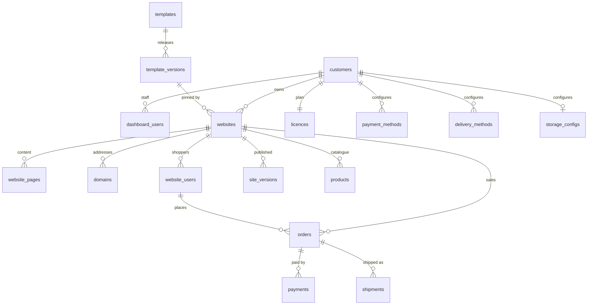
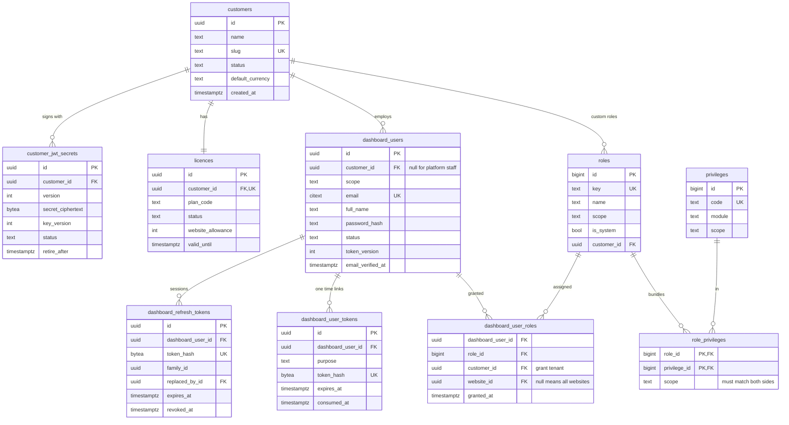
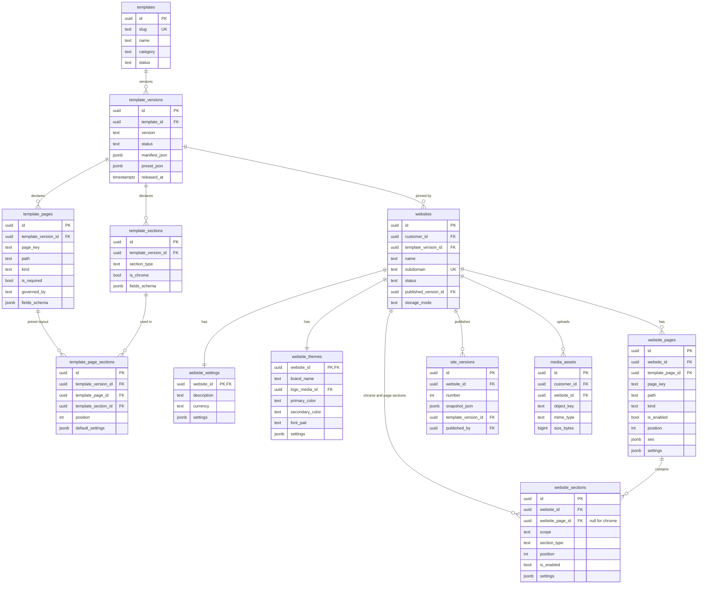
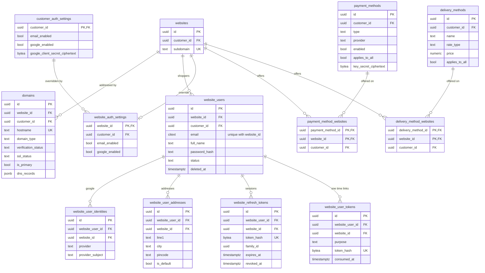
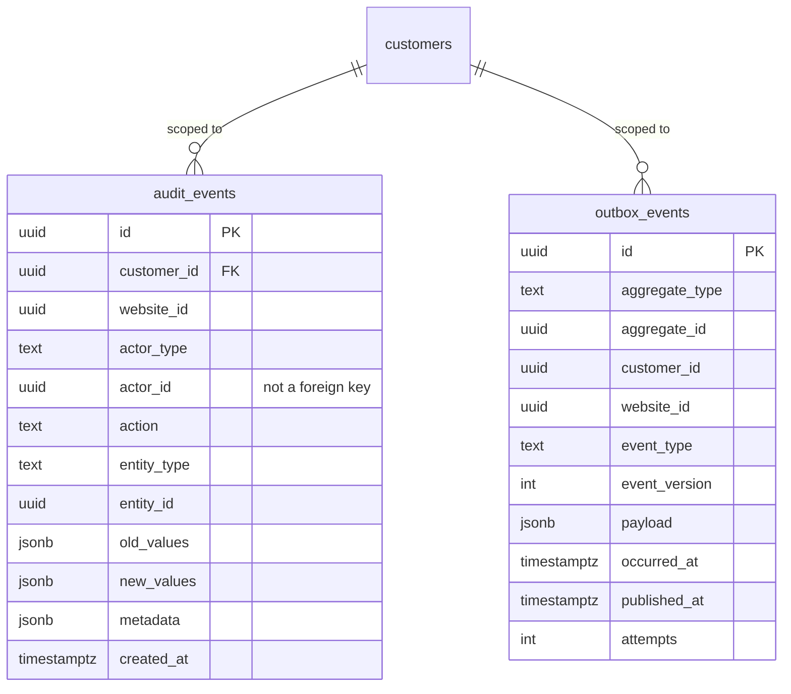

# Ryugaware Database Schema Design

> **Status: proposal for review. Nothing here has been implemented.**
> No migrations, no Go code, no SQL has been executed. The backend is at stage 4 of 18
> (`backend/PROJECT_STATE.md`): config, logger, errors and response envelopes only.
>
> Target: PostgreSQL 16+, accessed from a Go modular monolith (Gin + GORM + golang-migrate).
> Companion document: [`docs/ARCHITECTURE.md`](../ARCHITECTURE.md) — the platform architecture this
> schema serves.
>
> Written for a reviewer comfortable with Spring Boot and relational databases: where PostgreSQL
> behaves differently from what JPA/Hibernate would lead you to expect, it is called out.

---

## 1. Executive summary

Ryugaware is a multi-tenant website builder. One **customer** (the tenant, called *Organization* in
the dashboard) owns many **websites**, each created from a platform-owned **template**, each with
its own content, branding, domains, shoppers and orders.

The design rests on six decisions:

| # | Decision | Why |
|---|---|---|
| 1 | **Two separate identity systems**: `dashboard_users` (platform) and `website_users` (shoppers) | They have different lifecycles, different uniqueness rules and different token issuers. Merging them is the single most dangerous shortcut available here |
| 2 | **Template definition is separate from website instance** | A website is a deep copy of a template preset, pinned to a template version. Template changes must never reach a live website silently |
| 3 | **Pages and sections are relational rows, not one JSON blob** | They are queried, reordered, enabled and partially updated. Only each section's *settings* are JSONB, because their shape is declared by the template, not by the database |
| 4 | **Every website-owned row carries `website_id`, and children reference parents by composite key** | `(website_id, id)` unique keys plus composite foreign keys make a cross-website reference impossible to insert, not merely unlikely |
| 5 | **Published state is an immutable snapshot** (`site_versions`), the draft is the live rows | Publish, preview and rollback become a pointer change, and delivery reads one row instead of twenty joins |
| 6 | **Conservative indexing**: primary keys and business unique constraints only | Secondary indexes are proposed separately in §18 for explicit approval, as requested |

The schema is sized to what the frontend actually does today, plus the minimum needed to make it
secure and correct. Tables that the product will need but the frontend has not reached yet are
proposed separately and labelled, never mixed into the "required now" set (§20.1).

---

## 2. Existing frontend feature analysis

Everything below was read from `frontend/src/features/**` and `frontend/public/data/*.json`. The
frontend runs on a dummy in-browser API; these seed files are the de-facto current data contract.

### 2.1 Platform (dashboard) side

| Feature | Frontend source | Entities it implies |
|---|---|---|
| Sign up, sign in, verify email, reset password | `features/auth` (`AuthUser`, `RegisterInput`) | `dashboard_users`, email verification + reset tokens, `customers` (registration creates an organization) |
| Profile, licence | `features/account` (`User.role: owner/admin/member`, `License.allowance`) | role assignment, a plan/licence record limiting website count |
| Organisation settings, device sessions, change password | `features/settings` (`Organization`, `Session`) | `customers` columns, refresh-token rows surfaced as "sessions" |
| Websites list / create / rename / delete | `features/websites` (`Website`, `CreateWebsiteInput`) | `websites`, website creation copying a template preset |
| Template gallery, preview | `features/templates` (`Template`), `features/storefront/templates` | `templates`, `template_versions`, page and section definitions |
| Website editor: pages, sections, theme, SEO | `features/storefront` (`SiteContent`, `SitePage`, `SiteSection`, `SiteTheme`) | `website_pages`, `website_sections`, `website_themes`, `website_settings` |
| Publish | editor "Publish" → `Website.status`, `lastPublishedAt` | `site_versions`, `websites.published_version_id` |
| Domains | `features/domains` (`Domain`, `DnsRecord`, ssl/verification status) | `domains` |
| Payments: methods, transactions, revenue | `features/payments` (`PaymentMethod` with `appliesTo`/`websiteIds`, `Transaction`) | `payment_methods`, `payment_method_websites`, `payments` |
| Delivery: methods, shipments | `features/delivery` (`DeliveryMethod`, `Shipment`, `ShipmentEvent`) | `delivery_methods`, `delivery_method_websites`, `shipments`, `shipment_events` |
| Customers (shoppers) | `features/customers` (`Customer`, `CustomerAddress`, `CustomerOrder`) | `website_users`, `website_user_addresses`, `orders` |
| Customer sign-in settings | `features/customer-auth` (`default` + `overrides[websiteId]`) | `customer_auth_settings`, `website_auth_settings` |
| Storage | `features/storage` (`StorageConfig` with secret, `lastTest`, usage) | `storage_configs`, per-website storage mode |
| Contact details | `features/contact` (`default` + `overrides[websiteId]`) | `customer_contact_details`, `website_contact_details` |

### 2.2 Storefront (live website) side

Implemented in `features/storefront` and rendered at `/sites/<subdomain>`:

- Shopper **register / sign in / account page** with per-website accounts and Google sign-in →
  `website_users`, `website_user_identities`, `website_refresh_tokens`.
- **Browse**: catalogue with search, category filter, price filter, sorting, pagination; product page
  with variants, stock, specifications, related products → `products`, `product_variants`,
  `product_categories`, `inventory`.
- **Cart** → `carts`, `cart_items` (today: browser storage).
- **Checkout**: contact, address, delivery option, payment option, discount code → `orders`,
  `order_items`, `order_addresses`, `coupons`.
- **Payment step** (`/pay/:orderNumber`) with pending / paid / failed → `payments`.
- **Order confirmation and tracking** with an event timeline → `order_status_history`, `shipments`,
  `shipment_events`.
- **Reviews** with rating distribution and a submit form → `product_reviews`.
- **Newsletter** section → `newsletter_subscriptions`.

### 2.3 What the frontend fakes today, and what that means for the schema

| Frontend behaviour | Reality | Schema consequence |
|---|---|---|
| Catalogue is template demo data shared by every website | Not customer data | `products` and friends are **designed now, required next phase** (§20.1). Orders must reference them, so the shape matters today |
| Cart, shopper accounts and orders live in `localStorage` | Per browser | Needs real tables; the shapes are taken from the storefront types |
| Payment "gateway" is a simulated page | No provider call | `payments` models the real lifecycle (pending → paid/failed) so the simulation can be replaced without a migration |
| Shipment tracking advanced by a demo button | No carrier webhook | `shipment_events` is append-only and carrier-agnostic |
| Per-website method selection written to `appliesTo`/`websiteIds` | Correct model | Becomes `*_method_websites` join tables with `applies_to_all` |
| Dashboard roles are a single `role` string on the user | Too coarse for the stated requirements | `roles` / `privileges` / `role_privileges` / `dashboard_user_roles` (§7) |

### 2.4 Missing entities the frontend implies but does not have

1. **Granular dashboard permissions** — the product brief requires per-area access (content, domains,
   orders, read-only). The frontend has `owner | admin | member` only.
2. **Licence/plan record** — `License.allowance` gates website creation; today it is a seed file.
3. **Media/asset records** — logos and section images are data URLs in the editor. Real uploads need
   `media_assets` so storage keys, sizes and ownership are tracked.
4. **Outbox** — the backend plans Redis Streams consumers (`backend/PROJECT_STATE.md` event catalog);
   publishing reliably from a transaction needs `outbox_events`.
5. **Audit trail** — no frontend surface yet, but the platform brief lists audit events.

---

## 3. Database architecture

### 3.1 One database, one schema, module-owned tables

A single PostgreSQL database with a single `public` schema. Each Go module owns its tables and
exposes services; other modules call those services rather than reading the tables directly. This
mirrors the backend's existing module boundaries and keeps foreign keys and transactions available —
which is the entire point of choosing a modular monolith over services.

No per-tenant schema, no per-tenant database. Tenancy is a **column** (`customer_id`, `website_id`)
enforced by composite foreign keys. Schema-per-tenant does not survive thousands of tenants
(catalog bloat, migration fan-out, connection churn) and buys isolation that composite keys plus
application scoping already provide.

### 3.2 Identifiers

| Kind | Type | Used for |
|---|---|---|
| Business entities | `UUID` (v7 preferred, generated by the application) | `customers`, `websites`, `orders`, every tenant-owned row |
| Fixed system rows | `BIGINT GENERATED ALWAYS AS IDENTITY` | `roles`, `privileges` — small, seeded, referenced by stable keys |
| Human-facing references | separate `TEXT` column | `orders.order_number`, `websites.subdomain`, `domains.hostname` |

UUIDv7 is time-ordered, so index locality is close to a bigserial while staying unguessable in URLs
and safe to generate before insert. If the team prefers `gen_random_uuid()` (v4), note the B-tree
write amplification on high-insert tables (`payments`, `order_status_history`) and revisit.

**Never expose sequential integers for tenant data** — they leak volume and invite enumeration.

### 3.3 Types

| Need | Type | Note |
|---|---|---|
| Timestamps | `TIMESTAMPTZ` | Always. Store UTC; render in the customer's timezone (`customers.timezone`) |
| Money | `NUMERIC(12,2)` | Rupees. Never float. Gateway fees need 2 decimals (`fee: 100.72` in the seed data) |
| Percentages | `NUMERIC(5,2)` | `fee_percent` |
| Flags | `BOOLEAN NOT NULL DEFAULT` | No nullable booleans |
| Variable config | `JSONB` | Only where §15 justifies it |
| Secrets | `BYTEA` | Ciphertext only, never `TEXT` |
| Enumerations | `TEXT` + `CHECK` | See below |

**Enums: `TEXT` + `CHECK`, not PostgreSQL `ENUM` types.** Adding a value to a PG enum is easy, but
*removing* or reordering one requires a type rewrite, and enum values cannot be dropped at all. The
product's status vocabularies are still moving (`draft/live/paused`, shipment codes). A `CHECK`
constraint is altered with a single `ALTER TABLE ... DROP/ADD CONSTRAINT` and reads identically from
Go. The exception would be a vocabulary that is genuinely fixed forever; none qualifies yet.

### 3.4 Delete behaviour

| Relationship | Behaviour | Reason |
|---|---|---|
| `customers` → everything | `ON DELETE RESTRICT` | Deleting a tenant is an operational procedure (export, invoice, legal retention), never a cascade from a stray statement |
| `websites` → pages, sections, theme, settings, navigation | `ON DELETE CASCADE` | Content is meaningless without its website, and the frontend already deletes a website with its content |
| `websites` → orders, payments, shipments, website_users | `ON DELETE RESTRICT` | Financial and personal records outlive the website. Deleting a website with orders must be an explicit, audited archive operation |
| `website_pages` → `website_sections` | `ON DELETE CASCADE` | Same lifetime |
| `template_versions` → `websites` | `ON DELETE RESTRICT` | A pinned version cannot be removed while a website renders it |
| `orders` → `order_items`, `order_addresses`, `order_status_history` | `ON DELETE CASCADE` | Parts of one document |
| `products` → `order_items` | **No FK cascade**; `ON DELETE RESTRICT` + soft delete on products | An order line must keep its product reference *and* its own copy of name and price |

**Soft deletion is used in exactly three places** — `products`, `product_variants` and
`website_users` (`deleted_at TIMESTAMPTZ`) — because each is referenced by historical records that
must keep rendering. Everything else is deleted for real. Soft-deleting everything turns every query
into a landmine and is not justified here.

---

## 4. Naming conventions

| Thing | Convention | Example |
|---|---|---|
| Tables | plural, snake_case | `website_pages` |
| Join tables | both sides, singular-ish | `role_privileges`, `payment_method_websites` |
| Primary key | `id` | |
| Foreign key | `<referenced_table_singular>_id` | `website_id`, `template_version_id` |
| Booleans | `is_` / positive phrasing | `is_primary`, `enabled` |
| Timestamps | `*_at` | `created_at`, `published_at`, `deleted_at` |
| JSONB | `*_json` or a descriptive noun | `settings`, `manifest_json`, `snapshot_json` |
| Constraints | `pk_`, `uq_`, `fk_`, `ck_`, `idx_` + table + columns | `uq_website_users_website_email` |
| Enumerated text | lowercase snake values | `'out_for_delivery'` |

Timestamps: every table gets `created_at TIMESTAMPTZ NOT NULL DEFAULT now()`. Tables that are
updated in place also get `updated_at`, maintained by one shared trigger (§19). Append-only tables
(`*_events`, `order_status_history`, `outbox_events`, `audit_events`) deliberately have no
`updated_at` — they are never updated.

---

## 5. Tenant and user model

```
                      ┌───────────────────────────┐
                      │        customers          │  the tenant (dashboard "Organization")
                      └─────────────┬─────────────┘
          ┌─────────────────────────┼──────────────────────────┐
          │                         │                          │
   dashboard_users           websites (many)          org-wide configuration
   (manage the tenant)              │                 payment/delivery methods,
          │                         │                 storage, contact, auth defaults
   roles + privileges               │                          │
                                    │                 scoped to websites by join tables
                     ┌──────────────┼───────────────┐          │
                     │              │               │ ◄────────┘
              website content   website_users     commerce
              pages/sections    (shoppers)        products, orders, payments,
              theme/settings    addresses         shipments, reviews
              domains           sessions
```

**Three ownership levels**, and every table belongs to exactly one:

1. **Platform** — `templates`, `template_versions`, `roles` (system scope), `privileges`. No tenant column.
2. **Customer** — `dashboard_users`, `payment_methods`, `delivery_methods`, `storage_configs`,
   `customer_auth_settings`, `licences`. Column: `customer_id`.
3. **Website** — content, domains, shoppers, catalogue, orders. Columns: `website_id` **and**
   `customer_id` where it enables a composite chain (see §16.4).

### 5.1 Why dashboard users and website users are separate tables

| | `dashboard_users` | `website_users` |
|---|---|---|
| Who | Merchant staff, platform staff | Shoppers on a live website |
| Uniqueness | `UNIQUE (email)` globally | `UNIQUE (website_id, email)` |
| Token issuer | Platform JWT secret | **Per-customer** JWT secret |
| Lifecycle | Invited, role-assigned, deprovisioned | Self-registered, may be blocked, may be deleted on request |
| Authorises | Platform/tenant operations | Their own orders only |
| Volume | Tens per tenant | Unbounded |

One table with a discriminator would force the uniqueness rule to become conditional, make every
foreign key ambiguous, and put one bug between a shopper and a dashboard. They stay apart.

---

## 6. Authentication and authorization

### 6.1 Password storage

- **Argon2id** (`time=3, memory=64MB, parallelism=2`, tuned on the target hardware), encoded in the
  standard PHC string so parameters travel with the hash and can be upgraded on next login.
- A **pepper** from `AUTH_PASSWORD_PEPPER` (env / secrets manager) is applied before hashing.
  **The pepper is never stored in PostgreSQL** — that is the whole point of a pepper: a database dump
  alone must not be crackable.
- `password_hash TEXT NULL` — nullable because a shopper who only ever used Google has no password.
- `password_changed_at` supports the dashboard's "password changed" display and lets the application
  invalidate older sessions.

### 6.2 Customer JWT signing secrets

Each customer signs its **website users'** tokens with its own secret, so a leak is contained to one
tenant and a tenant can be rotated independently.

**Deviation from the brief, deliberately:** the brief suggests `customers.jwt_secret_encrypted`.
A single column cannot be rotated without invalidating every live token, because verification needs
the old secret until the last token issued under it expires. The design therefore uses a small
table, `customer_jwt_secrets`, with one `active` row and zero or more `retiring` rows:

- Encryption: envelope encryption. A data key encrypts the secret (AES-256-GCM); the data key is
  wrapped by a master key from KMS or `SECRETS_MASTER_KEY`. Stored as `BYTEA` with
  `key_version INT` so the master key can be rotated without re-reading every row at once.
- **This is not the password pepper.** Different purpose, different key, different rotation cadence,
  different blast radius. Reusing one for the other is explicitly forbidden in code review.
- Rotation: insert a new `active`, mark the old `retiring` with `retire_after = now() + refresh TTL`,
  verify against active + retiring, drop retiring rows past their window. Documented in §19.4.

### 6.3 Sessions and refresh tokens

Two tables, `dashboard_refresh_tokens` and `website_refresh_tokens`, deliberately **not** merged:
a shared table would need a polymorphic user reference and would lose the foreign key, which is the
one thing actually protecting the association. The duplication is 6 columns.

Rules for both:

- **Only a hash is stored**: `token_hash BYTEA NOT NULL` = SHA-256 of the opaque token. Plaintext
  tokens never touch the database. (bcrypt/Argon2 is unnecessary here: the token is already
  high-entropy and random, so a fast hash is correct and much cheaper per request.)
- **Rotation with reuse detection**: `family_id UUID` groups the chain, `replaced_by_id` links
  forward. Presenting a token that already has `replaced_by_id` means the token was stolen and
  replayed → revoke the entire family.
- `expires_at`, `revoked_at`, `revoked_reason`, `user_agent`, `ip`, `last_used_at`.
- The dashboard Settings "device sessions" list reads straight from `dashboard_refresh_tokens`
  (one live row per device) — no separate `login_sessions` table, which would be a duplicate with a
  different name.

Access tokens are **not** stored: they are short-lived (10–15 min) JWTs, verified by signature.

### 6.4 Cookie and token lifecycle

```
1.  POST /auth/login  — email + password
2.  Argon2id verify (with pepper). Failures: generic message, rate limited per email+IP (Redis)
3.  Access token  — JWT, 15 min, claims: sub, typ=dashboard|website, cid (customer), wid (website,
                    website users only), ver (token version), jti
4.  Refresh token — 32 random bytes, 30 days; SHA-256 stored in *_refresh_tokens with a family id
5.  Both delivered as cookies:
      HttpOnly; Secure; SameSite=Lax; Path=/            (dashboard, api.ryugaware.com)
      HttpOnly; Secure; SameSite=Lax; Domain=<website>  (shopper, scoped to that website's host)
    SameSite=Lax keeps normal navigation working while blocking cross-site POST CSRF.
    Cross-site storefront embedding would need SameSite=None; Secure — an open question (§24).
6.  Access token expires → client calls POST /auth/refresh with the refresh cookie
7.  Server: look up hash → check not expired, not revoked, not already replaced → issue a new pair,
    set replaced_by_id on the old row. Reuse of a replaced token revokes the family
8.  POST /auth/logout → revoked_at on that row (device) or the family (all devices)
```

**How a token finds its tenant.** The access token carries `cid` (and `wid` for shoppers), but the
claim is never trusted on its own:

- *Dashboard*: verify with the platform secret → load the user → `customer_id` comes **from the
  database row**, not the token. Every repository call is scoped by it.
- *Website user*: the request arrives on a hostname. The host resolves to a website (and therefore a
  customer) via `domains`; the token is verified with **that customer's** secret. A token minted by
  customer A cannot validate on customer B's host, because the signing key differs. The `wid` claim
  must equal the resolved website or the request is rejected.

### 6.5 Authorization model

- `privileges` — granular, named `module.action` (`website.publish`, `website.domains.manage`).
- `roles` — a named bundle. `scope = 'platform' | 'customer'`. System roles (`is_system`) are seeded
  and immutable; customers may create their own customer-scope roles.
- `role_privileges` — many-to-many, composite PK so a duplicate cannot exist.
- `dashboard_user_roles` — who has which role, **scoped**: `customer_id` must match the user's
  customer, and an optional `website_id` narrows the grant to one website ("this user manages orders
  on the Bloom Studio site only"). That optional column is what makes the brief's example — one user
  for content, one for domains, one for orders, one read-only — expressible without inventing a
  second permission system.

**Authorization is enforced in the application**, from a privilege set resolved per request (cached,
§14). The database enforces *ownership*, not *permission*: foreign keys guarantee a row belongs to a
tenant; they cannot know whether this user may update it.

---

## 7. Platform management tables

### 7.1 `customers`

The tenant. Created when someone registers on the dashboard (`RegisterInput.organizationName`).

| Column | Type | Constraints | Description |
|---|---|---|---|
| `id` | UUID | PK | Tenant identifier |
| `name` | TEXT | NOT NULL, len 1..120 | Organisation name shown in Settings |
| `slug` | TEXT | NOT NULL, UNIQUE | URL-safe handle, reserved for future tenant URLs |
| `status` | TEXT | NOT NULL, CHECK in (`active`,`suspended`,`closed`), default `active` | Suspension blocks dashboard login and unpublishes nothing automatically |
| `default_language` | TEXT | NOT NULL default `en-IN` | Settings page |
| `default_timezone` | TEXT | NOT NULL default `Asia/Kolkata` | Settings page |
| `default_currency` | CHAR(3) | NOT NULL default `INR` | Settings page |
| `created_at` / `updated_at` | TIMESTAMPTZ | NOT NULL | |

- **PK** `id`. **Unique** `slug`. **Tenant** itself. **Delete** RESTRICT from everywhere.
- No `email` column: the contact point is the owner dashboard user, and business contact details
  live in `customer_contact_details` (a different thing, shown on storefronts).

### 7.2 `customer_jwt_secrets`

Per-tenant signing material for **website user** tokens (§6.2).

| Column | Type | Constraints | Description |
|---|---|---|---|
| `id` | UUID | PK | |
| `customer_id` | UUID | NOT NULL, FK → `customers(id)` RESTRICT | Owner |
| `version` | INT | NOT NULL | Increments per rotation; goes in the JWT header as `kid` |
| `secret_ciphertext` | BYTEA | NOT NULL | AES-256-GCM ciphertext of the signing secret |
| `key_version` | INT | NOT NULL | Which master key wrapped it |
| `status` | TEXT | NOT NULL, CHECK in (`active`,`retiring`,`retired`) | |
| `retire_after` | TIMESTAMPTZ | NULL | While `retiring`, still accepted for verification until this time |
| `created_at` | TIMESTAMPTZ | NOT NULL | |

- **Unique** `(customer_id, version)`; partial unique `(customer_id) WHERE status='active'` — exactly
  one active secret per tenant. **Never** selected into logs or API responses.

### 7.3 `licences`

Gates website creation (`License.allowance` / `limitReached` in the frontend).

| Column | Type | Constraints | Description |
|---|---|---|---|
| `id` | UUID | PK | |
| `customer_id` | UUID | NOT NULL, UNIQUE, FK → `customers(id)` CASCADE | One live licence per tenant |
| `plan_code` | TEXT | NOT NULL | `starter`, `growth`, … |
| `status` | TEXT | NOT NULL, CHECK in (`active`,`expired`,`suspended`) | |
| `website_allowance` | INT | NOT NULL, CHECK >= 0 | Maximum websites |
| `valid_until` | TIMESTAMPTZ | NULL | NULL = perpetual |
| `created_at` / `updated_at` | TIMESTAMPTZ | NOT NULL | |

`used` and `remaining` are **not stored** — they are `COUNT(*)` over `websites`. Storing a counter
invites drift; enforcement is a transactional check at creation time (§16.5).

### 7.4 `dashboard_users`

| Column | Type | Constraints | Description |
|---|---|---|---|
| `id` | UUID | PK | |
| `customer_id` | UUID | NULL, FK → `customers(id)` RESTRICT | NULL = platform staff; NOT NULL = tenant staff |
| `scope` | TEXT | NOT NULL, CHECK in (`platform`,`customer`) | Explicit, so the NULL above is never ambiguous |
| `email` | CITEXT | NOT NULL, UNIQUE | Case-insensitive; dashboard emails are globally unique |
| `full_name` | TEXT | NOT NULL | |
| `password_hash` | TEXT | NULL | Argon2id PHC string; NULL only for invited-but-not-activated users |
| `password_changed_at` | TIMESTAMPTZ | NULL | Shown in Settings |
| `status` | TEXT | NOT NULL, CHECK in (`invited`,`active`,`suspended`) | |
| `email_verified_at` | TIMESTAMPTZ | NULL | |
| `token_version` | INT | NOT NULL default 0 | Bumped to invalidate all access tokens at once |
| `last_login_at` | TIMESTAMPTZ | NULL | |
| `created_at` / `updated_at` | TIMESTAMPTZ | NOT NULL | |

- **Check** `ck_dashboard_users_scope`: `(scope='platform' AND customer_id IS NULL) OR (scope='customer' AND customer_id IS NOT NULL)`.
- **Unique** `(id, customer_id)` — not redundant: it is the target of the composite foreign key from
  `dashboard_user_roles`, which is how a role grant is pinned to the right tenant.
- `CITEXT` needs `CREATE EXTENSION citext`. Alternative: `TEXT` + `UNIQUE (lower(email))`. Either is
  fine; the extension keeps queries readable.

**Why one table with a nullable `customer_id`** rather than `platform_users` + `customer_users`:
the login path, password rules, token handling and verification flow are identical, and splitting
them doubles the auth surface for one nullable column. The boundary is kept by the `scope` check,
the composite-key role grants, and a hard application rule: a `platform` user is never given a
`customer`-scope role, and a `customer` user can never hold a `platform`-scope role (§7.7).

### 7.5 `privileges`

| Column | Type | Constraints | Description |
|---|---|---|---|
| `id` | BIGINT | PK, identity | Small, stable, seeded |
| `code` | TEXT | NOT NULL, UNIQUE | `website.publish` — **the only thing application code refers to** |
| `module` | TEXT | NOT NULL | `website`, `domain`, `order`, `platform` — groups the permission UI |
| `description` | TEXT | NOT NULL | Shown when assigning |
| `scope` | TEXT | NOT NULL, CHECK in (`platform`,`customer`) | A customer role can only contain customer-scope privileges |

### 7.6 `roles`

| Column | Type | Constraints | Description |
|---|---|---|---|
| `id` | BIGINT | PK, identity | 1 = SuperAdmin, 2 = Admin (seeded) |
| `key` | TEXT | NOT NULL, UNIQUE | `super_admin`, `admin`, `owner`, `content_editor` — **code uses this, never the id** |
| `name` | TEXT | NOT NULL | Display name |
| `description` | TEXT | NOT NULL | |
| `scope` | TEXT | NOT NULL, CHECK in (`platform`,`customer`) | |
| `is_system` | BOOLEAN | NOT NULL default false | System roles cannot be edited or deleted by tenants |
| `customer_id` | UUID | NULL, FK → `customers(id)` CASCADE | NULL for system roles; set for tenant-created roles |
| `created_at` / `updated_at` | TIMESTAMPTZ | NOT NULL | |

- **Check**: `is_system = true` ⇒ `customer_id IS NULL`; `scope='platform'` ⇒ `customer_id IS NULL`.
- **Unique** `(id, scope)` and `(id, customer_id)` — again, targets for composite foreign keys.

### 7.7 `role_privileges`

| Column | Type | Constraints | Description |
|---|---|---|---|
| `role_id` | BIGINT | NOT NULL, FK → `roles(id)` CASCADE | |
| `privilege_id` | BIGINT | NOT NULL, FK → `privileges(id)` RESTRICT | |

- **PK** `(role_id, privilege_id)` — duplicates are impossible by construction.
- **Scope safety**: a `customer`-scope role must not contain a `platform`-scope privilege. Enforced
  with denormalised scope columns and a composite FK pair:
  `role_privileges(role_id, scope) → roles(id, scope)` and
  `role_privileges(privilege_id, scope) → privileges(id, scope)`. One `scope` column in the join
  table, checked against both sides — the database refuses the mix, no trigger needed.

### 7.8 `dashboard_user_roles`

| Column | Type | Constraints | Description |
|---|---|---|---|
| `dashboard_user_id` | UUID | NOT NULL | |
| `role_id` | BIGINT | NOT NULL, FK → `roles(id)` RESTRICT | |
| `customer_id` | UUID | NULL | Tenant the grant applies in; NULL only for platform roles |
| `website_id` | UUID | NULL | Narrows the grant to one website; NULL = all of the tenant's websites |
| `granted_by` | UUID | NULL, FK → `dashboard_users(id)` | Audit |
| `granted_at` | TIMESTAMPTZ | NOT NULL default now() | |

- **PK** `(dashboard_user_id, role_id, COALESCE(website_id, '00000000-…'))` — expressed as a unique
  index over `(dashboard_user_id, role_id, website_id)` plus a partial unique index for the NULL case,
  because PostgreSQL treats NULLs as distinct in a plain unique index (PG15+ could use
  `UNIQUE NULLS NOT DISTINCT`; the partial-index form works everywhere).
- **Composite FK 1**: `(dashboard_user_id, customer_id) → dashboard_users(id, customer_id)` — the
  grant's tenant must be the user's tenant. *A user cannot be given a role in another customer.*
- **Composite FK 2**: `(website_id, customer_id) → websites(id, customer_id)` — the website must
  belong to the same tenant.
- **Check**: `website_id IS NULL OR customer_id IS NOT NULL`.

> **PostgreSQL detail that matters here.** With the default `MATCH SIMPLE`, a composite foreign key
> is **not checked at all if any column is NULL**. Platform grants (`customer_id IS NULL`) therefore
> skip FK 1 — which is correct, there is no tenant to match — but it also means the check cannot be
> relied on for platform rows. Those are covered by the scope rule: a `platform` role is only ever
> granted to a `scope='platform'` user, enforced by application code and asserted in tests.

---

## 8. Template management tables

Platform-owned, read-only to tenants. Mirrors `features/storefront/templates`: a manifest (what is
editable) plus a preset (default content).

### 8.1 `templates`

| Column | Type | Constraints | Description |
|---|---|---|---|
| `id` | UUID | PK | |
| `slug` | TEXT | NOT NULL, UNIQUE | `aurelia-commerce` |
| `name` | TEXT | NOT NULL | |
| `description` | TEXT | NOT NULL | |
| `tagline` | TEXT | NOT NULL | Gallery card line |
| `category` | TEXT | NOT NULL, CHECK in (`ecommerce`,`services`) | |
| `status` | TEXT | NOT NULL, CHECK in (`draft`,`published`,`retired`) | Retired: no new websites, existing ones keep working |
| `preview_image_url` | TEXT | NULL | |
| `created_at` / `updated_at` | TIMESTAMPTZ | NOT NULL | |

### 8.2 `template_versions`

| Column | Type | Constraints | Description |
|---|---|---|---|
| `id` | UUID | PK | |
| `template_id` | UUID | NOT NULL, FK → `templates(id)` RESTRICT | |
| `version` | TEXT | NOT NULL | Semver, `1.0.0` |
| `status` | TEXT | NOT NULL, CHECK in (`draft`,`released`,`deprecated`) | |
| `manifest_json` | JSONB | NOT NULL | Field schemas, theme fields, defaults (§15.1) |
| `preset_json` | JSONB | NOT NULL | Default content copied at website creation (§15.2) |
| `released_at` | TIMESTAMPTZ | NULL | |
| `created_at` / `updated_at` | TIMESTAMPTZ | NOT NULL | |

- **Unique** `(template_id, version)`. **Delete** RESTRICT — a version with websites pinned to it
  can never be deleted; deprecate it instead.
- `manifest_json` and `preset_json` are duplicated into the relational tables below. The JSONB is the
  **release artifact** (what the renderer loads, versioned as one unit); the tables are the
  **queryable projection** (what the wizard and editor list). Both are written in one transaction at
  release time. See §15.1 for why this duplication is deliberate.

### 8.3 `template_pages`

| Column | Type | Constraints | Description |
|---|---|---|---|
| `id` | UUID | PK | |
| `template_version_id` | UUID | NOT NULL, FK → `template_versions(id)` CASCADE | |
| `page_key` | TEXT | NOT NULL | `landing`, `products`, `cart`, `account` |
| `path` | TEXT | NOT NULL | `/`, `/products/:slug` |
| `label` | TEXT | NOT NULL | |
| `description` | TEXT | NOT NULL | |
| `kind` | TEXT | NOT NULL, CHECK in (`content`,`system`) | `content` = arrangeable sections; `system` = functional route with fields |
| `is_required` | BOOLEAN | NOT NULL default false | Cannot be switched off |
| `required_reason` | TEXT | NULL | Shown in the wizard |
| `governed_by` | TEXT | NULL, CHECK in (`sign_in`) | Page exists only while that setting is on (account pages) |
| `position` | INT | NOT NULL | Listing order |
| `fields_schema` | JSONB | NOT NULL default `'[]'` | Editable fields for `system` pages |
| `allowed_sections` | TEXT[] | NOT NULL default `'{}'` | Section types permitted on `content` pages |

- **Unique** `(template_version_id, page_key)`, `(template_version_id, path)`.
- **Unique** `(id, template_version_id)` — target for the composite FK from `template_page_sections`.

### 8.4 `template_sections`

| Column | Type | Constraints | Description |
|---|---|---|---|
| `id` | UUID | PK | |
| `template_version_id` | UUID | NOT NULL, FK → `template_versions(id)` CASCADE | |
| `section_type` | TEXT | NOT NULL | `hero`, `product_showcase`, `footer` |
| `label` | TEXT | NOT NULL | |
| `description` | TEXT | NOT NULL | |
| `is_chrome` | BOOLEAN | NOT NULL default false | Header/footer/announcement: site-wide, not per page |
| `fields_schema` | JSONB | NOT NULL | The editor builds its form from this (§15.1) |

- **Unique** `(template_version_id, section_type)`, and `(id, template_version_id)` for composite FKs.

### 8.5 `template_page_sections`

The preset layout: which sections a page starts with, in what order, with what content.

| Column | Type | Constraints | Description |
|---|---|---|---|
| `id` | UUID | PK | |
| `template_version_id` | UUID | NOT NULL | Denormalised to carry the composite keys |
| `template_page_id` | UUID | NOT NULL | |
| `template_section_id` | UUID | NOT NULL | |
| `position` | INT | NOT NULL | |
| `is_enabled_by_default` | BOOLEAN | NOT NULL default true | |
| `default_settings` | JSONB | NOT NULL default `'{}'` | Default copy and images for this instance |

- **Composite FKs**: `(template_page_id, template_version_id) → template_pages(id, template_version_id)`
  and `(template_section_id, template_version_id) → template_sections(id, template_version_id)`.
  A page from version 1.0 can never be given a section from 1.1.
- **Unique** `(template_page_id, position)` — deferrable, so reordering within a transaction works.

---

## 9. Website management tables

### 9.1 `websites`

| Column | Type | Constraints | Description |
|---|---|---|---|
| `id` | UUID | PK | |
| `customer_id` | UUID | NOT NULL, FK → `customers(id)` RESTRICT | Tenant |
| `template_version_id` | UUID | NOT NULL, FK → `template_versions(id)` RESTRICT | **Pinned**: template releases do not move a live site |
| `name` | TEXT | NOT NULL | Dashboard label |
| `subdomain` | TEXT | NOT NULL, UNIQUE | Platform address; also a `domains` row (§11) |
| `type` | TEXT | NOT NULL, CHECK in (`ecommerce`,`services`) | From the template category |
| `status` | TEXT | NOT NULL, CHECK in (`draft`,`live`,`paused`), default `draft` | Matches the dashboard badge |
| `published_version_id` | UUID | NULL, FK → `site_versions(id)` RESTRICT | NULL = never published. What visitors get |
| `storage_mode` | TEXT | NOT NULL, CHECK in (`platform`,`connected`), default `connected` | Per-website media location (editor → Store settings) |
| `last_published_at` | TIMESTAMPTZ | NULL | |
| `created_at` / `updated_at` | TIMESTAMPTZ | NOT NULL | |

- **Unique** `(id, customer_id)` — the anchor for every tenant chain in §16.
- **Delete** RESTRICT from `customers`; CASCADE **to** content; RESTRICT from orders and shoppers.
- `subdomain` is globally unique and separately validated (reserved words: `www`, `api`, `admin`…).

### 9.2 `website_settings` (1:1)

| Column | Type | Constraints | Description |
|---|---|---|---|
| `website_id` | UUID | PK, FK → `websites(id)` CASCADE | One row per website |
| `description` | TEXT | NOT NULL default `''` | Default meta description |
| `locale` | TEXT | NOT NULL | Inherited from the customer at creation |
| `timezone` | TEXT | NOT NULL | |
| `currency` | CHAR(3) | NOT NULL | |
| `favicon_media_id` | UUID | NULL, FK → `media_assets(id)` SET NULL | |
| `settings` | JSONB | NOT NULL default `'{}'` | Small, open-ended website options (§15.5) |
| `created_at` / `updated_at` | TIMESTAMPTZ | NOT NULL | |

### 9.3 `website_themes` (1:1)

| Column | Type | Constraints | Description |
|---|---|---|---|
| `website_id` | UUID | PK, FK → `websites(id)` CASCADE | |
| `brand_name` | TEXT | NOT NULL | Wordmark when no logo |
| `brand_description` | TEXT | NOT NULL default `''` | |
| `logo_media_id` | UUID | NULL, FK → `media_assets(id)` SET NULL | |
| `primary_color` | TEXT | NOT NULL, CHECK `^#[0-9A-Fa-f]{6}$` | |
| `secondary_color` | TEXT | NOT NULL, CHECK `^#[0-9A-Fa-f]{6}$` | |
| `font_pair` | TEXT | NOT NULL, CHECK in (`serif`,`sans`) | |
| `settings` | JSONB | NOT NULL default `'{}'` | Template-declared theme fields beyond the fixed four (§15.4) |
| `created_at` / `updated_at` | TIMESTAMPTZ | NOT NULL | |

The four branding values are columns, not JSONB, because they are rendered on every request,
validated identically for every template, and shown in list views. Anything a *template* adds to the
theme schema goes in `settings`.

### 9.4 `website_pages`

The customer-owned copy of a template page. Created by copying the preset; never shared.

| Column | Type | Constraints | Description |
|---|---|---|---|
| `id` | UUID | PK | |
| `website_id` | UUID | NOT NULL | Tenant |
| `template_page_id` | UUID | NULL, FK → `template_pages(id)` SET NULL | Provenance; NULL if the page's definition was retired |
| `page_key` | TEXT | NOT NULL | Stable key, survives template upgrades |
| `path` | TEXT | NOT NULL | Route within the storefront |
| `title` | TEXT | NOT NULL | Customer-editable |
| `kind` | TEXT | NOT NULL, CHECK in (`content`,`system`) | |
| `is_enabled` | BOOLEAN | NOT NULL default true | Switched off pages keep their content (§19.5) |
| `position` | INT | NOT NULL | |
| `seo` | JSONB | NOT NULL default `'{}'` | `{title, description, og_image_media_id}` |
| `settings` | JSONB | NOT NULL default `'{}'` | Values for a `system` page's declared fields (§15.3) |
| `created_at` / `updated_at` | TIMESTAMPTZ | NOT NULL | |

- **Unique** `(website_id, page_key)`, `(website_id, path)`.
- **Unique** `(id, website_id)` — target for `website_sections`.
- **FK** `(website_id) → websites(id)` CASCADE.

### 9.5 `website_sections`

Section instances. One table covers both page sections and site-wide chrome; `scope` says which.

| Column | Type | Constraints | Description |
|---|---|---|---|
| `id` | UUID | PK | |
| `website_id` | UUID | NOT NULL | Tenant |
| `website_page_id` | UUID | NULL | NULL ⇔ `scope='chrome'` |
| `scope` | TEXT | NOT NULL, CHECK in (`page`,`chrome`) | Chrome = announcement bar, header, footer |
| `template_section_id` | UUID | NULL, FK → `template_sections(id)` SET NULL | Provenance |
| `section_type` | TEXT | NOT NULL | Stable key the renderer dispatches on |
| `position` | INT | NOT NULL | |
| `is_enabled` | BOOLEAN | NOT NULL default true | Hidden sections keep their content |
| `settings` | JSONB | NOT NULL default `'{}'` | The editable content of this instance (§15.3) |
| `created_at` / `updated_at` | TIMESTAMPTZ | NOT NULL | |

- **Composite FK** `(website_page_id, website_id) → website_pages(id, website_id)` CASCADE — a
  section cannot be attached to another website's page. **This is the central isolation guarantee of
  the editor.**
- **Check** `ck_website_sections_scope`: `(scope='page' AND website_page_id IS NOT NULL) OR (scope='chrome' AND website_page_id IS NULL)`.
- **Unique** `(website_page_id, position)` deferrable; partial unique `(website_id, section_type) WHERE scope='chrome'`
  — one header, one footer, one announcement bar per website.

### 9.6 `site_versions`

Immutable published snapshots.

| Column | Type | Constraints | Description |
|---|---|---|---|
| `id` | UUID | PK | |
| `website_id` | UUID | NOT NULL, FK → `websites(id)` RESTRICT | |
| `number` | INT | NOT NULL | 1, 2, 3 … per website |
| `snapshot_json` | JSONB | NOT NULL | The whole resolved website: theme, chrome, pages, sections, media URLs, commerce options (§15.6) |
| `template_version_id` | UUID | NOT NULL, FK → `template_versions(id)` RESTRICT | Which renderer this snapshot expects |
| `note` | TEXT | NULL | Optional publish note |
| `published_by` | UUID | NULL, FK → `dashboard_users(id)` SET NULL | |
| `created_at` | TIMESTAMPTZ | NOT NULL | No `updated_at`: snapshots are never updated |

- **Unique** `(website_id, number)` and `(id, website_id)`.
- **This is the one place a whole-website JSON document is correct**: it is immutable, read as a
  unit by the public renderer, and never partially updated. §15.6 explains the trade-off.

**Draft / preview / publish / rollback at the data level**

| Operation | What happens |
|---|---|
| Edit | `UPDATE website_pages / website_sections / website_themes`. The live site is untouched |
| Preview | Render **from the draft rows** behind a signed preview token; `noindex`; no cache |
| Publish | One transaction: build the snapshot → `INSERT site_versions (number = max+1)` → `UPDATE websites SET published_version_id, last_published_at, status='live'` → `INSERT outbox_events('site.published')`. A worker purges the edge cache |
| Rollback | `UPDATE websites SET published_version_id = <older id>` plus an outbox event. One row |
| Unpublish | `published_version_id = NULL`, `status='paused'` |

### 9.7 `media_assets`

Needed as soon as logos and section images stop being data URLs.

| Column | Type | Constraints | Description |
|---|---|---|---|
| `id` | UUID | PK | |
| `customer_id` | UUID | NOT NULL, FK → `customers(id)` RESTRICT | |
| `website_id` | UUID | NULL | NULL = shared across the tenant's websites |
| `storage_mode` | TEXT | NOT NULL, CHECK in (`platform`,`connected`) | Which bucket it landed in |
| `object_key` | TEXT | NOT NULL | Key within the bucket |
| `mime_type` | TEXT | NOT NULL | |
| `size_bytes` | BIGINT | NOT NULL | Feeds the storage usage figure |
| `width` / `height` | INT | NULL | |
| `alt_text` | TEXT | NOT NULL default `''` | Accessibility |
| `checksum` | BYTEA | NULL | De-duplication |
| `created_at` | TIMESTAMPTZ | NOT NULL | |

- **Composite FK** `(website_id, customer_id) → websites(id, customer_id)`.
- **Unique** `(customer_id, storage_mode, object_key)`.

### 9.8 Organisation configuration with per-website overrides

Three settings are configured once for the tenant and may be overridden per website. The frontend
already models this exactly (`default` + `overrides[websiteId]`), so the schema mirrors it: a
customer-level row, plus an optional website-level row. **Absence of the website row means inherit** —
no null-flags, no duplicated defaults.

| Table | Grain | Key columns |
|---|---|---|
| `customer_auth_settings` | 1 per customer | `email_enabled`, `email_allow_signups`, `email_require_verification`, `email_min_password_length`, `session_days`, `google_enabled`, `google_client_id`, `google_client_secret_ciphertext`, `google_allowed_domains TEXT[]` |
| `website_auth_settings` | 0..1 per website | same columns; presence = override |
| `customer_contact_details` | 1 per customer | `business_name`, `contact_person`, `support_email`, `phone`, `whatsapp`, `support_hours`, address columns, `show_in_footer`, `show_on_contact_page`, `show_on_invoices` |
| `website_contact_details` | 0..1 per website | same columns; presence = override |
| `storage_configs` | 1 per customer | `provider`, `endpoint`, `bucket`, `region`, `access_key_id`, `secret_ciphertext BYTEA`, `path_prefix`, `public_base_url`, `force_path_style`, `status`, `last_test JSONB`, `connected_at` |

- Website-level tables: **PK `website_id`**, FK → `websites(id)` CASCADE, plus `customer_id` with a
  composite FK `(website_id, customer_id) → websites(id, customer_id)`.
- Storage is **tenant-level only**; the per-website choice is `websites.storage_mode`, because the
  product offers "this website's media in your bucket or ours", not a second bucket.
- `google_client_secret_ciphertext` and `secret_ciphertext` are `BYTEA`, encrypted with the same
  envelope scheme as §6.2 — **never** JSONB, never plaintext (§15.8).

---

## 10. Website user tables

### 10.1 `website_users`

Shoppers. Entirely separate from `dashboard_users` (§5.1).

| Column | Type | Constraints | Description |
|---|---|---|---|
| `id` | UUID | PK | |
| `website_id` | UUID | NOT NULL, FK → `websites(id)` RESTRICT | The shopper belongs to exactly one website |
| `customer_id` | UUID | NOT NULL | Denormalised for tenant chains and dashboard queries |
| `email` | CITEXT | NOT NULL | |
| `full_name` | TEXT | NOT NULL | |
| `phone` | TEXT | NULL | |
| `password_hash` | TEXT | NULL | NULL when the account is Google-only |
| `password_changed_at` | TIMESTAMPTZ | NULL | |
| `status` | TEXT | NOT NULL, CHECK in (`active`,`blocked`,`unverified`), default `unverified` | Matches the dashboard Customers page |
| `email_verified_at` | TIMESTAMPTZ | NULL | |
| `avatar_media_id` | UUID | NULL, FK → `media_assets(id)` SET NULL | |
| `token_version` | INT | NOT NULL default 0 | Force-logout without deleting rows |
| `marketing_opt_in` | BOOLEAN | NOT NULL default false | |
| `last_active_at` | TIMESTAMPTZ | NULL | Shown in the dashboard |
| `deleted_at` | TIMESTAMPTZ | NULL | Soft delete: orders must still render |
| `created_at` / `updated_at` | TIMESTAMPTZ | NOT NULL | |

- **Required unique constraint**: `uq_website_users_website_email UNIQUE (website_id, email)`.
  The same person may hold unrelated accounts on two of the tenant's websites, which is the
  product's intent.
- **Unique** `(id, website_id)` — target for addresses, carts, orders, reviews.
- **Composite FK** `(website_id, customer_id) → websites(id, customer_id)`.
- **Delete**: RESTRICT from `websites`. Erasure requests are handled by an anonymise routine
  (clear name/email/phone, keep the order history) — see the open question in §24.
- `orders`, `total_spent` shown in the dashboard are **aggregates**, not columns (§7.3 reasoning).

### 10.2 `website_user_identities`

Google sign-in is already implemented per website, and a shopper may later add a password, so the
provider link is its own row rather than a `sign_in_method` enum.

| Column | Type | Constraints | Description |
|---|---|---|---|
| `id` | UUID | PK | |
| `website_user_id` | UUID | NOT NULL | |
| `website_id` | UUID | NOT NULL | Carried for the composite FK |
| `provider` | TEXT | NOT NULL, CHECK in (`google`) | More providers later |
| `provider_subject` | TEXT | NOT NULL | Google `sub` — stable, not the email |
| `email_at_link` | CITEXT | NULL | What the provider reported when linked |
| `created_at` | TIMESTAMPTZ | NOT NULL | |

- **Unique** `(website_id, provider, provider_subject)` — one Google account maps to one shopper per
  website. **Composite FK** `(website_user_id, website_id) → website_users(id, website_id)` CASCADE.

### 10.3 `website_user_addresses`

| Column | Type | Constraints | Description |
|---|---|---|---|
| `id` | UUID | PK | |
| `website_user_id` | UUID | NOT NULL | |
| `website_id` | UUID | NOT NULL | |
| `label` | TEXT | NOT NULL default `'Home'` | |
| `recipient_name` / `phone` | TEXT | NOT NULL | |
| `line1` | TEXT | NOT NULL | |
| `line2` | TEXT | NOT NULL default `''` | |
| `city` / `state` | TEXT | NOT NULL | |
| `pincode` | TEXT | NOT NULL, CHECK `^[1-9][0-9]{5}$` | Indian PIN |
| `country` | CHAR(2) | NOT NULL default `IN` | |
| `is_default` | BOOLEAN | NOT NULL default false | |
| `created_at` / `updated_at` | TIMESTAMPTZ | NOT NULL | |

- **Composite FK** `(website_user_id, website_id) → website_users(id, website_id)` CASCADE.
- Partial unique `(website_user_id) WHERE is_default` — at most one default address.

### 10.4 `website_refresh_tokens`

Same shape and rules as `dashboard_refresh_tokens` (§6.3), pointing at `website_users`, plus
`website_id` and its composite FK so a token can never be redeemed against another website.

| Column | Type | Constraints |
|---|---|---|
| `id` | UUID | PK |
| `website_user_id`, `website_id` | UUID | NOT NULL, composite FK → `website_users(id, website_id)` CASCADE |
| `token_hash` | BYTEA | NOT NULL, UNIQUE |
| `family_id` | UUID | NOT NULL |
| `replaced_by_id` | UUID | NULL, FK → self SET NULL |
| `issued_at`, `expires_at` | TIMESTAMPTZ | NOT NULL |
| `revoked_at` | TIMESTAMPTZ | NULL |
| `revoked_reason` | TEXT | NULL |
| `user_agent`, `ip` | TEXT / INET | NULL |
| `last_used_at` | TIMESTAMPTZ | NULL |

### 10.5 `website_user_tokens`

One-time links: email verification and password reset for shoppers.

| Column | Type | Constraints | Description |
|---|---|---|---|
| `id` | UUID | PK | |
| `website_user_id`, `website_id` | UUID | NOT NULL, composite FK CASCADE | |
| `purpose` | TEXT | NOT NULL, CHECK in (`email_verification`,`password_reset`) | One table, two purposes |
| `token_hash` | BYTEA | NOT NULL, UNIQUE | Never the plaintext token |
| `expires_at` | TIMESTAMPTZ | NOT NULL | |
| `consumed_at` | TIMESTAMPTZ | NULL | Single use |
| `created_at` | TIMESTAMPTZ | NOT NULL | |

`dashboard_user_tokens` is the identical table for dashboard users (purposes: `email_verification`,
`password_reset`, `invitation`).

---

## 11. Domain management tables

### 11.1 `domains`

| Column | Type | Constraints | Description |
|---|---|---|---|
| `id` | UUID | PK | |
| `website_id` | UUID | NOT NULL | |
| `customer_id` | UUID | NOT NULL | For the composite chain and tenant queries |
| `hostname` | TEXT | NOT NULL, **UNIQUE platform-wide** | Lowercased, punycode for IDN |
| `domain_type` | TEXT | NOT NULL, CHECK in (`platform_subdomain`,`custom`) | Different lifecycles |
| `verification_status` | TEXT | NOT NULL, CHECK in (`pending_dns`,`verifying`,`active`,`failed`) | Matches the dashboard |
| `verification_token` | TEXT | NULL | TXT challenge value |
| `dns_records` | JSONB | NOT NULL default `'[]'` | Last check result: required records and whether each was found (§15.7) |
| `ssl_status` | TEXT | NOT NULL, CHECK in (`none`,`pending`,`issued`,`failed`), default `none` | |
| `ssl_expires_at` | TIMESTAMPTZ | NULL | Renewal scheduling |
| `is_primary` | BOOLEAN | NOT NULL default false | Others 301 to it |
| `failure_reason` | TEXT | NULL | Shown in the dashboard |
| `last_checked_at` | TIMESTAMPTZ | NULL | |
| `created_at` / `updated_at` | TIMESTAMPTZ | NOT NULL | |

- **`UNIQUE (hostname)` is the ownership policy**: a hostname can be claimed by exactly one website
  across the whole platform. Two tenants cannot both claim `shop.example.com`; the second gets a
  conflict and must prove ownership through support after the first releases it.
- **Partial unique** `(website_id) WHERE is_primary` — at most one primary per website.
- **Composite FK** `(website_id, customer_id) → websites(id, customer_id)` CASCADE.
- **Check**: a `platform_subdomain` row must end in the platform suffix and is created with the
  website; a `custom` row starts at `pending_dns`.
- **Transfer / removal**: deleting the row frees the hostname immediately; the edge must drop the
  certificate and stop serving. Moving a hostname between websites of the *same* tenant is an
  `UPDATE website_id` (audited). Across tenants it is delete + re-add, so DNS proof is repeated.

---

## 12. E-commerce tables

> **Scope note.** The storefront renders a catalogue today, but that catalogue is template demo
> data, not customer data. Products, variants and categories are therefore designed here and
> classified **required next phase** (§20.1); orders, payments and shipments already exist in the
> dashboard and are **required now**. Nothing in this section is speculative beyond what the
> implemented screens show.

### 12.1 Organisation-level commerce configuration

| Table | Grain | Notes |
|---|---|---|
| `payment_methods` | per customer | `type` (`card`,`upi`,`netbanking`,`wallet`,`cod`), `provider`, `display_name`, `enabled`, `test_mode`, `fee_percent NUMERIC(5,2)`, `fee_fixed NUMERIC(12,2)`, `min_order`, `max_order`, `key_id`, `key_secret_ciphertext BYTEA`, `applies_to_all BOOLEAN` |
| `payment_method_websites` | join | `(payment_method_id, website_id)` PK + `customer_id`; rows exist only when `applies_to_all = false` |
| `delivery_methods` | per customer | `name`, `type`, `carrier`, `min_days`, `max_days`, `rate_type` (`flat`,`free`,`free_above`), `price`, `free_above`, `coverage`, `regions TEXT[]`, `enabled`, `applies_to_all` |
| `delivery_method_websites` | join | `(delivery_method_id, website_id)` PK + `customer_id` |

- **Composite FKs on both join tables**: `(payment_method_id, customer_id) → payment_methods(id, customer_id)`
  and `(website_id, customer_id) → websites(id, customer_id)`. A tenant cannot attach its method to
  another tenant's website — the database refuses it.
- `applies_to_all = true` means "every website this tenant has, including ones created later", which
  is the semantic the editor and the Payments page already share. When a website is deselected, the
  application converts the method to explicit rows in the same transaction.
- Gateway credentials are `BYTEA` ciphertext. `key_id` (e.g. `rzp_live_…`) is not secret and stays
  plaintext for display; the dashboard only ever shows a masked form.

### 12.2 Catalogue

| Table | Purpose | Key columns and constraints |
|---|---|---|
| `products` | A sellable item on one website | `website_id`, `slug`, `name`, `summary`, `description`, `status` (`draft`,`active`,`archived`), `base_price NUMERIC(12,2)`, `compare_at_price`, `rating_avg NUMERIC(2,1)`, `review_count INT`, `specs JSONB`, `deleted_at`. **Unique** `(website_id, slug)`, `(id, website_id)` |
| `product_variants` | Size/colour/capacity with its own stock | `product_id`, `website_id`, `label`, `sku`, `price_delta`, `is_active`, `deleted_at`. Composite FK `(product_id, website_id) → products(id, website_id)`. **Unique** `(website_id, sku)`, `(id, website_id)` |
| `product_images` | Ordered gallery | `product_id`, `website_id`, `media_asset_id`, `position`. Composite FK as above |
| `product_categories` | Browsing taxonomy | `website_id`, `slug`, `name`, `blurb`, `image_media_id`, `position`. **Unique** `(website_id, slug)` |
| `product_category_mappings` | Many-to-many | PK `(product_id, product_category_id)` + `website_id`, both sides composite-FK'd to the same website |
| `inventory` | Stock per variant | PK `product_variant_id`; `website_id`, `on_hand INT`, `reserved INT`, `updated_at`. CHECK `on_hand >= 0 AND reserved >= 0` |

`collections` / `collection_products` are **not** proposed yet: the storefront's "featured / new /
best sellers" rows are rule-based (`source` on the section), not hand-curated lists. They become
necessary the moment a merchant wants to pick products by hand — recorded in §20.1 as future.

### 12.3 Cart

| Table | Purpose | Key columns |
|---|---|---|
| `carts` | One open cart per shopper or guest session | `website_id`, `website_user_id NULL`, `guest_token_hash BYTEA NULL`, `status` (`open`,`converted`,`abandoned`), `currency`, `expires_at`. Composite FK to `website_users(id, website_id)`; CHECK exactly one of user/guest is set; partial unique `(website_id, website_user_id) WHERE status='open'` |
| `cart_items` | Lines | `cart_id`, `website_id`, `product_id`, `product_variant_id`, `quantity INT CHECK > 0`, `unit_price`. Composite FKs to cart and variant. **Unique** `(cart_id, product_variant_id)` |

Prices are copied onto the line at add-time and re-validated at checkout; a cart must not silently
re-price.

### 12.4 Orders

| Table | Purpose | Key columns |
|---|---|---|
| `orders` | The commercial document | `website_id`, `customer_id`, `order_number` **UNIQUE (website_id, order_number)**, `website_user_id NULL` (guest checkout), `contact_email`, `contact_phone`, `status` (`placed`,`confirmed`,`processing`,`shipped`,`delivered`,`cancelled`,`refunded`), `payment_status` (`pending`,`paid`,`failed`,`cod_due`,`refunded`), `currency`, `subtotal`, `shipping_total`, `discount_total`, `tax_total`, `grand_total`, `delivery_method_id NULL`, `payment_method_id NULL`, `coupon_id NULL`, `placed_at`, `estimated_delivery_at`. **Unique** `(id, website_id)` |
| `order_items` | Immutable lines | `order_id`, `website_id`, `product_id NULL`, `product_variant_id NULL`, **`product_name`, `variant_label`, `unit_price`, `quantity`, `line_total`** copied at purchase, `image_media_id NULL`. Composite FK to the order |
| `order_addresses` | Shipping and billing | `order_id`, `website_id`, `kind` (`shipping`,`billing`), full address columns. **Unique** `(order_id, kind)` |
| `order_status_history` | Append-only audit of status | `order_id`, `website_id`, `from_status NULL`, `to_status`, `note`, `actor_type` (`system`,`dashboard_user`,`website_user`), `actor_id NULL`, `created_at` |

**Why the line copies name and price**: a product may be renamed, repriced, archived or
soft-deleted; an order from last March must still print what was actually bought at what price. The
`product_id` stays as a reference for reporting, with `ON DELETE RESTRICT` backed by soft delete.

### 12.5 Payments

| Table | Purpose | Key columns |
|---|---|---|
| `payments` | One attempt to collect money for an order | `order_id`, `website_id`, `payment_method_id NULL`, `method_type`, `provider`, `provider_payment_id NULL` (`pay_8KJ2M9`), `method_label` (`Visa •••• 4242`), `amount`, `fee NUMERIC(12,2)`, `status` (`pending`,`succeeded`,`failed`,`refunded`), `failure_reason NULL`, `authorized_at`, `captured_at`, `refunded_at`, `provider_payload JSONB`. Composite FK `(order_id, website_id) → orders(id, website_id)`. **Unique** `(provider, provider_payment_id)` where not null |
| `refunds` | Partial or full reversal | `payment_id`, `website_id`, `amount`, `reason`, `status`, `provider_refund_id`, `created_at`. **Required next phase** — the dashboard shows refunded transactions but has no refund action yet |

The dashboard's Transactions page is a view over `payments` joined to `orders` and `website_users`.
A separate `payment_transactions` table is **not** proposed: one row per attempt already is the
transaction log, and webhook deliveries belong in `provider_payload` plus `audit_events`.

### 12.6 Shipping

| Table | Purpose | Key columns |
|---|---|---|
| `shipments` | A parcel for an order | `order_id`, `website_id`, `delivery_method_id NULL`, `carrier`, `awb NULL`, `tracking_url NULL`, `status` (`processing`,`in_transit`,`out_for_delivery`,`delivered`,`failed`,`returned`), `item_count`, `failure_reason NULL`, `eta NULL`, `shipped_at`, `delivered_at`. Composite FK to the order. **Unique** `(id, website_id)`; **unique** `(carrier, awb)` where awb not null |
| `shipment_events` | Append-only carrier timeline | `shipment_id`, `website_id`, `code` (`placed`,`packed`,`picked_up`,`in_transit`,`out_for_delivery`,`delivered`,`failed`,`returned`), `occurred_at`, `location`, `note`, `source` (`carrier`,`manual`,`system`), `created_at`. Composite FK to the shipment |

An order may have more than one shipment (split consignment), which is why `shipments` is not merged
into `orders`.

### 12.7 Discounts

| Table | Purpose | Key columns |
|---|---|---|
| `coupons` | The `WELCOME10` code at checkout | `website_id`, `code`, `kind` (`percent`,`fixed`), `value NUMERIC(12,2)`, `min_order_total NULL`, `max_redemptions NULL`, `per_user_limit NULL`, `starts_at`, `ends_at`, `is_active`. **Unique** `(website_id, upper(code))` |
| `coupon_redemptions` | Who used it, on which order | `coupon_id`, `website_id`, `order_id`, `website_user_id NULL`, `amount_discounted`, `created_at`. **Unique** `(coupon_id, order_id)`; composite FKs to coupon and order |

Redemption counts are derived from this table, not a counter column — a counter plus concurrent
checkouts is a race waiting to be written.

### 12.8 Reviews and subscriptions

| Table | Purpose | Key columns |
|---|---|---|
| `product_reviews` | Rating and text on a product | `product_id`, `website_id`, `website_user_id NULL`, `order_id NULL` (verified purchase), `author_name`, `rating SMALLINT CHECK 1..5`, `title`, `body`, `status` (`pending`,`published`,`rejected`), `created_at`. Composite FKs to product and user. **Unique** `(product_id, website_user_id) WHERE website_user_id IS NOT NULL` — one review per shopper per product |
| `newsletter_subscriptions` | The newsletter section | `website_id`, `email CITEXT`, `website_user_id NULL`, `status` (`subscribed`,`unsubscribed`), `source`, `confirmed_at`, `created_at`. **Unique** `(website_id, email)` |

`products.rating_avg` / `review_count` are denormalised deliberately: the listing sorts by rating
and shows counts on every card. They are recalculated in the same transaction that publishes or
removes a review, and a nightly job re-checks them. This is the one documented duplication in the
schema (§16.6).

---

## 13. Audit and event tables

### 13.1 `audit_events`

Who did what, in which tenant. Written by **application services**, not triggers (§19.3).

| Column | Type | Constraints | Description |
|---|---|---|---|
| `id` | UUID | PK | |
| `customer_id` | UUID | NULL, FK → `customers(id)` RESTRICT | NULL for platform-level actions |
| `website_id` | UUID | NULL | Set when the action targets one website |
| `actor_type` | TEXT | NOT NULL, CHECK in (`dashboard_user`,`website_user`,`system`,`api`) | |
| `actor_id` | UUID | NULL | Not an FK: the actor may be deleted later and the trail must survive |
| `actor_label` | TEXT | NULL | Email or name at the time of the action |
| `action` | TEXT | NOT NULL | `website.published`, `domain.verified`, `role.assigned` |
| `entity_type` | TEXT | NOT NULL | `website`, `domain`, `order` |
| `entity_id` | UUID | NULL | |
| `old_values` | JSONB | NULL | Changed fields only, secrets redacted |
| `new_values` | JSONB | NULL | Same |
| `metadata` | JSONB | NOT NULL default `'{}'` | `{ip, user_agent, request_id}` |
| `created_at` | TIMESTAMPTZ | NOT NULL default now() | No `updated_at`: append-only |

Partitioning by month (`PARTITION BY RANGE (created_at)`) once volume justifies it — noted, not done
now. Retention is an open question (§24).

### 13.2 `outbox_events`

The transactional outbox. The backend already plans Redis Streams with `audit-worker` and
`notification-worker` consumer groups; this table is what makes that delivery reliable.

| Column | Type | Constraints | Description |
|---|---|---|---|
| `id` | UUID | PK | Becomes the stream `event_id`, giving consumers idempotency |
| `aggregate_type` | TEXT | NOT NULL | `website`, `order`, `domain` |
| `aggregate_id` | UUID | NOT NULL | |
| `customer_id` | UUID | NULL | Lets a consumer route or filter by tenant |
| `website_id` | UUID | NULL | |
| `event_type` | TEXT | NOT NULL | `site.published`, `order.paid` |
| `event_version` | INT | NOT NULL default 1 | Payload schema version |
| `payload` | JSONB | NOT NULL | No secrets (§15.8) |
| `occurred_at` | TIMESTAMPTZ | NOT NULL default now() | |
| `published_at` | TIMESTAMPTZ | NULL | Set by the relay once accepted by Redis |
| `attempts` | INT | NOT NULL default 0 | |
| `last_error` | TEXT | NULL | |

**Why an outbox at all.** Publishing to Redis inside a database transaction gives you exactly the
wrong guarantees: the transaction can roll back after the publish (phantom event) or the publish can
fail after the commit (lost event). Writing the event as a row in the *same* transaction makes the
business change and the intent to publish atomic. A relay then reads unpublished rows and pushes
them to Redis Streams — at-least-once, with `id` as the idempotency key consumers already expect.

Trade-offs, honestly: one extra table and a relay process (a goroutine with `SELECT … FOR UPDATE
SKIP LOCKED`), a small write amplification, and ordering only within an aggregate. The alternative —
publishing inline — is simpler until the first lost order event.

**Events worth emitting now** (matching the backend's catalog): `site.published`,
`site.unpublished`, `domain.verified`, `domain.failed`, `order.placed`, `order.paid`,
`order.payment_failed`, `shipment.status_changed`, `dashboard_user.invited`, `role.assigned`.

---

## 14. Cache strategy

PostgreSQL is the source of truth. Redis holds copies that can be rebuilt. **No authorization or
ownership decision is ever made from Redis alone.**

### 14.1 Keys and TTLs

| Key | Contents | TTL | Invalidated by |
|---|---|---|---|
| `rw:{env}:host:{hostname}` | `{website_id, customer_id, published_version_id, status}` | 60 s | domain change, publish, unpublish |
| `rw:{env}:site:{website_id}:v{n}` | Published snapshot JSON | 24 h (immutable content) | never — a new publish writes a new key |
| `rw:{env}:site:{website_id}:current` | Current version number | 5 min | publish, rollback |
| `rw:{env}:cust:{customer_id}:config` | Locale, currency, status, licence allowance | 10 min | customer or licence update |
| `rw:{env}:cust:{customer_id}:commerce:{website_id}` | Resolved payment/delivery/sign-in options | 5 min | any store-settings change |
| `rw:{env}:dbu:{user_id}:privs` | Resolved privilege codes with their website scope | 5 min | role or privilege change, user suspension |
| `rw:{env}:ratelimit:login:{email_hash}:{ip}` | Counter | 15 min | expiry |

Conventions: `rw:` prefix, environment segment, **tenant segment before entity**, version suffix on
anything immutable. A tenant's keys can then be scanned and dropped as a unit.

### 14.2 Rules

- **Never cached**: password hashes, refresh tokens, decrypted JWT secrets, gateway credentials,
  anything from a `*_ciphertext` column. If a decrypted signing key must be held hot, it lives in
  process memory with a short TTL, never in Redis.
- **Always from PostgreSQL**: licence enforcement at website creation, stock decrements, payment
  status transitions, role changes being *written*, anything inside a money transaction.
- **Redis unavailable** → every read falls through to PostgreSQL and the request still succeeds,
  slower. The only feature that degrades is rate limiting, which fails closed for login (deny when
  the counter cannot be read) and open for read-only endpoints. This is a deliberate asymmetry.
- **Invalidation is explicit**, triggered by the same service that wrote the change, after commit —
  or by an outbox consumer for cross-process cases such as edge purges.

---

## 15. JSONB strategy

JSONB is used in exactly nine places. For each: why, who owns it, how it is validated, whether it is
versioned.

### 15.1 `template_versions.manifest_json`

- **Why**: the template declares its own fields; the database cannot have a column per template.
- **Owner**: the platform, at release time. Immutable afterwards.
- **Validated**: against a JSON Schema in the release pipeline before the row is written.
- **Versioned**: yes — by the `template_versions` row itself.
- **Duplication note**: §8.3–8.5 project the same information into relational tables so the wizard
  and editor can list pages and sections without parsing JSON. Both are written in one transaction;
  the manifest is the artifact, the tables are the index. The alternative (tables only) would force
  the renderer to re-assemble a manifest on every request.

```jsonc
{ "sections": { "hero": { "label": "Hero banner",
      "fields": [ { "key": "heading", "type": "text", "max": 70, "required": true },
                  { "key": "ctaTarget", "type": "link" } ] } },
  "themeFields": [ { "key": "primary", "type": "color" } ] }
```

### 15.2 `template_versions.preset_json`

Default content read **once**, at website creation. Owner: platform. Same validation and versioning
as the manifest.

### 15.3 `website_pages.settings` and `website_sections.settings`

- **Why**: the shape is declared by the template, differs per section type, and changes with template
  versions. Columns are impossible; an EAV table would be a thousand rows per website and unreadable.
- **Owner**: the customer, through the editor.
- **Validated**: server-side against the section's `fields_schema` on every write — the same schema
  the editor built its form from. Unknown keys rejected, lengths enforced, link targets checked
  against the website's own pages.
- **Versioned**: indirectly, through `websites.template_version_id`. A section whose type no longer
  exists is skipped by the renderer rather than crashing it.

```jsonc
{ "heading": "Made well. Kept long.", "ctaLabel": "Shop the collection",
  "ctaTarget": { "type": "page", "page_key": "products" },
  "image": { "media_id": "0191f2…" }, "layout": "split" }
```

> Links and images are stored as **references**, not strings: `{type:"page", page_key}` and
> `{media_id}`. Renaming a page or replacing an image then cannot break a section, and the
> application can validate the reference on write. This is the main reason a `navigation_items`
> table is *not* needed yet — but also exactly what it would buy us: real foreign keys on those
> references (§20.1).

### 15.4 `website_themes.settings`

Template-declared theme fields beyond the four fixed columns. Owner: customer. Validated against
`manifest_json.themeFields`.

### 15.5 `website_settings.settings`

Small website-level switches that are not worth a column yet. Owner: customer. **Guard**: anything
read on every request or filtered on in a list gets promoted to a column.

### 15.6 `site_versions.snapshot_json`

- **Why**: the public renderer must read one immutable document, not twenty joins, and the published
  site must not change when the draft does.
- **Owner**: the publishing service.
- **Validated**: assembled server-side from validated rows; media URLs and page links are **resolved**
  so delivery does no joins at all.
- **Versioned**: by `number`, and tied to `template_version_id`.
- **This is the documented exception to "no giant JSON documents".** It is immutable, write-once,
  read-whole — the properties that make a document correct. The *draft* stays relational, which is
  what the rule is actually protecting.

### 15.7 `domains.dns_records`

Last verification result (`[{type, host, value, found}]`). Owner: the domain checker. Rebuildable;
kept so the dashboard can show instructions and progress without a live DNS query.

### 15.8 `payments.provider_payload`, `storage_configs.last_test`, `audit_events.*`, `outbox_events.payload`

Provider responses and diagnostics, whose shape belongs to someone else. **Secrets are stripped
before writing**: no card numbers (PAN), no CVV, no gateway secret keys, no tokens, no password
hashes. A redaction allow-list is applied in the service layer, and a code-review rule says a
`*_ciphertext` column may never be copied into a JSONB field.

### 15.9 What is deliberately *not* JSONB

Page order, section order, enabled flags, theme colours, prices, stock, order totals, statuses,
domain hostnames, role grants. All queried, sorted, filtered or constrained — all columns.

---

## 16. Tenant isolation and composite constraints

Three independent layers. They are not substitutes for one another.

| Layer | Prevents | Does not prevent |
|---|---|---|
| **Application scoping** — every repository method takes a tenant and adds it to the `WHERE` | Ordinary cross-tenant reads | A forgotten `WHERE`, a new query written in a hurry |
| **Composite foreign keys** — the schema | *Writing* a row that points across tenants, under any code path | Reading another tenant's row if the `WHERE` is missing |
| **RLS** (optional, §16.7) | Reads too, including from psql | Nothing, but costs operational complexity |

### 16.1 The pattern

Every website-owned table carries `website_id`. Every table that is a child of a website-owned row
carries `website_id` **as well** and references its parent by `(parent_id, website_id)`:

```sql
-- the parent exposes a composite key
ALTER TABLE orders ADD CONSTRAINT uq_orders_id_website UNIQUE (id, website_id);

-- the child must name the same website as its parent
ALTER TABLE order_items
  ADD CONSTRAINT fk_order_items_order
  FOREIGN KEY (order_id, website_id) REFERENCES orders (id, website_id) ON DELETE CASCADE;
```

An `order_item` on website B pointing at an order on website A is now **not insertable**. No trigger,
no application check, no race.

### 16.2 The customer chain

`websites` exposes `UNIQUE (id, customer_id)`, so tenant-level configuration can be pinned the same
way:

```sql
ALTER TABLE payment_method_websites
  ADD CONSTRAINT fk_pmw_website
  FOREIGN KEY (website_id, customer_id) REFERENCES websites (id, customer_id) ON DELETE CASCADE,
  ADD CONSTRAINT fk_pmw_method
  FOREIGN KEY (payment_method_id, customer_id) REFERENCES payment_methods (id, customer_id) ON DELETE CASCADE;
```

Both sides are forced into the same tenant by the shared `customer_id` column.

### 16.3 Correction to the brief's illustrative SQL

The brief's example is not valid and should not be copied:

```sql
-- ✗ invalid: one column referencing a two-column key
ALTER TABLE orders ADD CONSTRAINT fk_orders_website
  FOREIGN KEY (website_id) REFERENCES websites (customer_id, id);
```

A foreign key must have the same number of columns, in the same order, as the referenced unique
constraint. The correct forms are:

```sql
-- ✓ simple ownership
FOREIGN KEY (website_id) REFERENCES websites (id)
-- ✓ tenant-pinned ownership (requires UNIQUE (id, customer_id) on websites)
FOREIGN KEY (website_id, customer_id) REFERENCES websites (id, customer_id)
```

### 16.4 Where the composite pattern is applied

| Child | References | Enforces |
|---|---|---|
| `website_sections` | `website_pages(id, website_id)` | A section belongs to a page of its own website |
| `website_user_addresses`, `website_user_identities`, `website_refresh_tokens`, `website_user_tokens` | `website_users(id, website_id)` | A shopper's data cannot cross websites |
| `order_items`, `order_addresses`, `order_status_history`, `payments`, `shipments`, `coupon_redemptions` | `orders(id, website_id)` | Order documents stay whole and on one website |
| `shipment_events` | `shipments(id, website_id)` | |
| `product_variants`, `product_images`, `product_category_mappings`, `product_reviews` | `products(id, website_id)` | |
| `cart_items` | `carts(id, website_id)` and `product_variants(id, website_id)` | A cart cannot hold another website's product |
| `domains`, `media_assets`, `website_auth_settings`, `website_contact_details` | `websites(id, customer_id)` | Tenant-pinned |
| `payment_method_websites`, `delivery_method_websites` | both sides, through `customer_id` | Config cannot be attached across tenants |
| `dashboard_user_roles` | `dashboard_users(id, customer_id)` and `websites(id, customer_id)` | A role grant cannot cross tenants |

### 16.5 Rules the database cannot express

Enforced in the application, inside the relevant transaction, and covered by tests:

1. **Licence allowance** — `SELECT count(*) FROM websites WHERE customer_id = $1 FOR UPDATE` on the
   licence row, then insert. A CHECK cannot count rows in another table.
2. **Platform users never hold customer roles** (§7.8, the MATCH SIMPLE gap).
3. **Required pages cannot be disabled**; **governed pages follow the sign-in setting** — both are
   template semantics, not data integrity.
4. **Payment/delivery method with no website left** is switched off (the product rule behind
   `applies_to_all`).
5. **Stock never goes negative** — `CHECK (on_hand >= 0)` catches the write, but the *reservation*
   logic (decrement on payment, release on failure) is application-side with row locks.

### 16.6 Documented duplications

Only three, each with a reason: `products.rating_avg` / `review_count` (listing performance),
`website_users.customer_id` and similar denormalised tenant columns (they *are* the isolation
mechanism), and `order_items`' copies of name and price (historical accuracy). Everything else is
derived on read.

### 16.7 Row-Level Security: evaluated, not adopted now

RLS would add a fourth layer: `CREATE POLICY ... USING (customer_id = current_setting('app.customer_id')::uuid)`.

Operationally it requires:

- `SET LOCAL app.customer_id` at the start of **every** transaction. With PgBouncer in *transaction*
  pooling this is safe (settings are rolled back with the transaction); in *session* pooling it
  leaks between tenants — a serious footgun.
- `FORCE ROW LEVEL SECURITY`, because the table owner bypasses policies by default; and a dedicated
  non-owner application role.
- Policies on ~40 tables, kept in step with every migration, plus bypass paths for the relay,
  migrations and admin tooling.
- A measurable planner cost on every query, and harder debugging (queries silently return nothing).

**Recommendation**: not in phase 1. The composite-key layer already blocks the dangerous case
(writing across tenants). Revisit RLS when the first non-Go consumer (analytics, BI, a reporting
tool) gets direct database access — that is when application scoping stops covering everything.

---

## 17. Primary keys, unique constraints and foreign keys

### 17.1 Business unique constraints (the rules that matter)

| Table | Constraint | Business rule |
|---|---|---|
| `dashboard_users` | `UNIQUE (email)` | One dashboard login per email, platform-wide |
| `website_users` | `UNIQUE (website_id, email)` | **The brief's core requirement**: same person, independent accounts per website |
| `website_user_identities` | `UNIQUE (website_id, provider, provider_subject)` | One Google account → one shopper per website |
| `websites` | `UNIQUE (subdomain)` | Platform addresses do not collide |
| `domains` | `UNIQUE (hostname)` | One hostname, one website, platform-wide |
| `domains` | partial `UNIQUE (website_id) WHERE is_primary` | At most one primary domain |
| `roles` | `UNIQUE (key)` | Code refers to keys, not ids |
| `privileges` | `UNIQUE (code)` | |
| `role_privileges` | `PK (role_id, privilege_id)` | No duplicate mapping |
| `dashboard_user_roles` | unique over `(user, role, website)` incl. the NULL case | No duplicate grant |
| `website_pages` | `UNIQUE (website_id, page_key)`, `UNIQUE (website_id, path)` | One route, one page |
| `website_sections` | partial `UNIQUE (website_id, section_type) WHERE scope='chrome'` | One header/footer/announcement |
| `site_versions` | `UNIQUE (website_id, number)` | Version numbers are per website |
| `orders` | `UNIQUE (website_id, order_number)` | Human reference unique per shop |
| `products` | `UNIQUE (website_id, slug)`; `product_variants` `UNIQUE (website_id, sku)` | |
| `coupons` | `UNIQUE (website_id, upper(code))` | Codes are case-insensitive |
| `*_refresh_tokens`, `*_user_tokens` | `UNIQUE (token_hash)` | A hash identifies exactly one token |
| `customer_jwt_secrets` | partial `UNIQUE (customer_id) WHERE status='active'` | One active signing key |

### 17.2 Composite unique keys that exist only as FK targets

`(id, customer_id)` on `websites`, `dashboard_users`, `payment_methods`, `delivery_methods`;
`(id, website_id)` on `website_pages`, `website_users`, `orders`, `products`, `product_variants`,
`carts`, `shipments`, `site_versions`. These are redundant for uniqueness (`id` is already unique)
but **required** to be referenceable by composite foreign keys. Their indexes are the cost of the
isolation guarantee, and they are useful anyway for tenant-scoped lookups.

### 17.3 Foreign key behaviour summary

Spelled out per relationship in §3.4; every FK in the DDL states its action explicitly. There are no
`ON UPDATE CASCADE` clauses: primary keys are immutable UUIDs and never change.

---

## 18. Indexing strategy

**Policy: primary keys and business unique constraints only in the initial schema.** PostgreSQL
creates a supporting index for each automatically, and those are the only indexes the first
migration will contain.

Two facts worth stating, because they surprise people coming from other databases:

1. A `UNIQUE` constraint **creates** a B-tree index. Nothing extra is needed to make those lookups fast.
2. PostgreSQL does **not** index foreign key columns automatically. An unindexed FK column is fine
   for insert/update of the child, but makes `ON DELETE CASCADE` and parent deletes scan the child
   table.

### 18.1 Secondary indexes proposed for approval (not in the initial DDL)

| # | Table and columns | Query it serves | Benefit | Cost | Needed |
|---|---|---|---|---|---|
| 1 | `website_sections (website_page_id, position)` | Render a page's sections in order | Every storefront draft render and every editor open | One index on a medium table | **Now** — this is the hottest draft query |
| 2 | `website_pages (website_id)` | Editor page list, publish assembly | Avoids a seq scan per website | Small | **Now** |
| 3 | `orders (website_id, placed_at DESC)` | Dashboard order list, shopper account page | Pagination without sorting the table | Moderate write cost | **Now**, once orders exist |
| 4 | `payments (website_id, created_at DESC)` | Transactions page with date filters | Same | Moderate | **Now**, once payments exist |
| 5 | `website_users (website_id, created_at DESC)` | Customers page | Same | Small | **Now** |
| 6 | `audit_events (customer_id, created_at DESC)` | Audit trail | Append-heavy table | Grows forever — partition first | Later |
| 7 | `outbox_events (published_at) WHERE published_at IS NULL` | Relay polling | Keeps the relay O(unpublished) | Tiny partial index | **Now**, with the relay |
| 8 | `shipment_events (shipment_id, occurred_at)` | Tracking timeline | Small | Small | Later |
| 9 | `products (website_id, status)` | Storefront catalogue listing | Avoids scanning archived rows | Small | With the catalogue |
| 10 | GIN on any JSONB column | None today | — | Large write cost | **No.** Not until a query actually filters inside JSONB |

Nothing else — no index on every foreign key, no speculative composite indexes. The list above is
deliberately short and each entry names the screen that needs it.

---

## 19. Database triggers

### 19.1 `set_updated_at()` — the only general-purpose trigger

```sql
CREATE OR REPLACE FUNCTION set_updated_at() RETURNS trigger
LANGUAGE plpgsql AS $$
BEGIN
  NEW.updated_at := now();
  RETURN NEW;
END $$;
```

Attached (`BEFORE UPDATE FOR EACH ROW`) to every table that has an `updated_at` column, and to no
others. Append-only tables have no `updated_at` and no trigger.

### 19.2 Optional guard trigger

`guard_immutable_tenant()` — raises if `website_id` or `customer_id` changes on UPDATE. Proposed for
`orders`, `payments` and `website_sections` only. A CHECK cannot compare `OLD` and `NEW`, so this is
one of the few cases where a trigger is the right tool. Classified **recommended, not essential**:
no application path updates those columns today.

### 19.3 What triggers must never do

No HTTP calls, no `pg_notify` to drive business logic, no email, no Redis, no writes to other
tenants' rows. The reasons are practical: a trigger runs inside someone else's transaction, cannot
be retried independently, is invisible in application traces, and turns a slow network call into a
held lock. **Audit rows and outbox rows are written by services**, which know the actor, the request
id and the intent — none of which a trigger can see.

A generic row-diff audit trigger was considered and rejected for exactly that reason: it would
record `old_values`/`new_values` but attribute every change to "the database".

### 19.4 Secret rotation procedures (operational, not triggers)

| Secret | Rotation |
|---|---|
| Customer JWT signing secret | Insert new `active`, mark previous `retiring` with `retire_after = now() + refresh_ttl`, verify against both, delete retired rows by job |
| Master encryption key | Bump `key_version`, re-wrap `*_ciphertext` rows in batches, keep both master keys loaded until the count of old-version rows is zero |
| Password pepper | Cannot be rotated in place. Requires `password_hash_pepper_version` on the user row and re-hashing on next successful login. **Recorded as an open question** (§24) — it is a real cost of using a pepper |
| Gateway credentials | Customer-initiated; overwrite the ciphertext, keep an audit event, never log the value |

### 19.5 Disabled pages and sections keep their content

`is_enabled = false` is a flag. No content is deleted, no row is removed, and re-enabling restores
exactly what was there — which the editor already relies on.

---

## 20. Complete table reference

### 20.1 Classification

**A — Required for current frontend functionality** (the screens exist and are used today)

`customers`, `licences`, `dashboard_users`, `websites`, `website_settings`, `website_themes`,
`website_pages`, `website_sections`, `site_versions`, `templates`, `template_versions`,
`template_pages`, `template_sections`, `template_page_sections`, `domains`, `website_users`,
`website_user_identities`, `website_user_addresses`, `payment_methods`, `payment_method_websites`,
`delivery_methods`, `delivery_method_websites`, `customer_auth_settings`, `website_auth_settings`,
`customer_contact_details`, `website_contact_details`, `storage_configs`, `orders`, `order_items`,
`order_addresses`, `order_status_history`, `payments`, `shipments`, `shipment_events`,
`product_reviews`, `newsletter_subscriptions`, `media_assets`.

**B — Required for platform security and data integrity** (no screen yet; the platform is unsafe without them)

`privileges`, `roles`, `role_privileges`, `dashboard_user_roles`, `customer_jwt_secrets`,
`dashboard_refresh_tokens`, `website_refresh_tokens`, `dashboard_user_tokens`, `website_user_tokens`,
`audit_events`, `outbox_events`.

**C — Required for the next implementation phase** (the storefront renders them from demo data today)

`products`, `product_variants`, `product_images`, `product_categories`,
`product_category_mappings`, `inventory`, `carts`, `cart_items`, `coupons`, `coupon_redemptions`,
`refunds`.

**D — Future, deliberately not designed in detail**

`collections` / `collection_products` (hand-curated product lists — the storefront's rows are
rule-based today); `navigations` / `navigation_items` (navigation lives in chrome section settings,
§15.3); `inventory_movements` (a stock ledger — `inventory` plus `order_status_history` is enough
until returns and multi-warehouse exist); `tax_rates`; `webhooks`; `api_keys`; `invoices`.

### 20.2 At a glance

| Table | Owner | PK | Tenant column(s) | Delete from parent |
|---|---|---|---|---|
| `customers` | platform | id | — | RESTRICT |
| `customer_jwt_secrets` | customer | id | customer_id | CASCADE |
| `licences` | customer | id | customer_id | CASCADE |
| `dashboard_users` | customer/platform | id | customer_id (nullable) | RESTRICT |
| `dashboard_refresh_tokens` | customer | id | — (via user) | CASCADE |
| `dashboard_user_tokens` | customer | id | — (via user) | CASCADE |
| `privileges` / `roles` | platform | id (bigint) | customer_id on custom roles | CASCADE |
| `role_privileges` | platform | (role_id, privilege_id) | — | CASCADE |
| `dashboard_user_roles` | customer | composite unique | customer_id, website_id | CASCADE |
| `templates` / `template_versions` | platform | id | — | RESTRICT |
| `template_pages` / `template_sections` / `template_page_sections` | platform | id | — | CASCADE from version |
| `websites` | customer | id | customer_id | RESTRICT |
| `website_settings` / `website_themes` | website | website_id | website_id | CASCADE |
| `website_pages` / `website_sections` | website | id | website_id | CASCADE |
| `site_versions` | website | id | website_id | RESTRICT |
| `media_assets` | customer | id | customer_id, website_id | RESTRICT |
| `domains` | website | id | website_id, customer_id | CASCADE |
| `website_users` | website | id | website_id, customer_id | RESTRICT |
| `website_user_identities` / `_addresses` / `_refresh_tokens` / `_tokens` | website | id | website_id | CASCADE |
| `payment_methods` / `delivery_methods` | customer | id | customer_id | CASCADE |
| `payment_method_websites` / `delivery_method_websites` | customer | composite | customer_id, website_id | CASCADE |
| `customer_auth_settings` / `customer_contact_details` / `storage_configs` | customer | customer_id | customer_id | CASCADE |
| `website_auth_settings` / `website_contact_details` | website | website_id | website_id, customer_id | CASCADE |
| `products` … `inventory` | website | id | website_id | RESTRICT / CASCADE per §12.2 |
| `carts` / `cart_items` | website | id | website_id | CASCADE |
| `orders` | website | id | website_id, customer_id | RESTRICT |
| `order_items` / `order_addresses` / `order_status_history` | website | id | website_id | CASCADE |
| `payments` / `refunds` | website | id | website_id | CASCADE from order |
| `shipments` / `shipment_events` | website | id | website_id | CASCADE from order/shipment |
| `coupons` / `coupon_redemptions` | website | id | website_id | CASCADE |
| `product_reviews` / `newsletter_subscriptions` | website | id | website_id | CASCADE |
| `audit_events` / `outbox_events` | platform | id | customer_id, website_id (nullable) | RESTRICT |

---

## 21. ER diagrams

### 21.1 High-level overview



### 21.2 Platform identity and authorization



### 21.3 Templates and website management



### 21.4 Website users, domains and per-website configuration



### 21.5 E-commerce

```mermaid
erDiagram
    products {
        uuid id PK
        uuid website_id FK
        text slug
        text name
        numeric base_price
        text status
        numeric rating_avg
        int review_count
        timestamptz deleted_at
    }
    product_variants {
        uuid id PK
        uuid product_id FK
        uuid website_id FK
        text label
        text sku
        numeric price_delta
    }
    product_images {
        uuid id PK
        uuid product_id FK
        uuid website_id FK
        uuid media_asset_id FK
        int position
    }
    product_categories {
        uuid id PK
        uuid website_id FK
        text slug
        text name
    }
    product_category_mappings {
        uuid product_id PK,FK
        uuid product_category_id PK,FK
        uuid website_id FK
    }
    inventory {
        uuid product_variant_id PK,FK
        uuid website_id FK
        int on_hand
        int reserved
    }
    carts {
        uuid id PK
        uuid website_id FK
        uuid website_user_id FK
        bytea guest_token_hash
        text status
    }
    cart_items {
        uuid id PK
        uuid cart_id FK
        uuid website_id FK
        uuid product_variant_id FK
        int quantity
        numeric unit_price
    }
    orders {
        uuid id PK
        uuid website_id FK
        uuid customer_id FK
        text order_number
        uuid website_user_id FK
        text status
        text payment_status
        numeric grand_total
        timestamptz placed_at
    }
    order_items {
        uuid id PK
        uuid order_id FK
        uuid website_id FK
        uuid product_id FK
        uuid product_variant_id FK
        text product_name
        numeric unit_price
        int quantity
    }
    order_addresses {
        uuid id PK
        uuid order_id FK
        uuid website_id FK
        text kind
        text line1
        text city
        text pincode
    }
    order_status_history {
        uuid id PK
        uuid order_id FK
        uuid website_id FK
        text from_status
        text to_status
        text actor_type
        timestamptz created_at
    }
    payments {
        uuid id PK
        uuid order_id FK
        uuid website_id FK
        uuid payment_method_id FK
        text provider_payment_id
        numeric amount
        numeric fee
        text status
        jsonb provider_payload
    }
    refunds {
        uuid id PK
        uuid payment_id FK
        uuid website_id FK
        numeric amount
        text status
    }
    shipments {
        uuid id PK
        uuid order_id FK
        uuid website_id FK
        uuid delivery_method_id FK
        text carrier
        text awb
        text status
        timestamptz eta
    }
    shipment_events {
        uuid id PK
        uuid shipment_id FK
        uuid website_id FK
        text code
        timestamptz occurred_at
        text location
    }
    coupons {
        uuid id PK
        uuid website_id FK
        text code
        text kind
        numeric value
    }
    coupon_redemptions {
        uuid id PK
        uuid coupon_id FK
        uuid website_id FK
        uuid order_id FK
        numeric amount_discounted
    }
    product_reviews {
        uuid id PK
        uuid product_id FK
        uuid website_id FK
        uuid website_user_id FK
        smallint rating
        text status
    }
    newsletter_subscriptions {
        uuid id PK
        uuid website_id FK
        citext email
        text status
    }
    products ||--o{ product_variants : "sold as"
    products ||--o{ product_images : "gallery"
    products ||--o{ product_category_mappings : "categorised"
    product_categories ||--o{ product_category_mappings : "contains"
    product_variants ||--|| inventory : "stock"
    carts ||--o{ cart_items : "lines"
    product_variants ||--o{ cart_items : "added as"
    orders ||--o{ order_items : "lines"
    orders ||--o{ order_addresses : "shipping and billing"
    orders ||--o{ order_status_history : "transitions"
    orders ||--o{ payments : "collected by"
    payments ||--o{ refunds : "reversed by"
    orders ||--o{ shipments : "fulfilled by"
    shipments ||--o{ shipment_events : "timeline"
    coupons ||--o{ coupon_redemptions : "redeemed"
    orders ||--o| coupon_redemptions : "discounted by"
    products ||--o{ product_reviews : "reviewed"
```



### 21.6 Audit and events



---

## 22. PostgreSQL DDL

Ordered so that every referenced table exists before the constraint that needs it. Written for
review, not for execution: it has not been run against a database, and the migration task should
re-verify it. Per §18, **no secondary indexes are included** — only the indexes PostgreSQL creates
for primary keys and unique constraints.

```sql
-- ============================================================
-- 0. Extensions and shared helpers
-- ============================================================
CREATE EXTENSION IF NOT EXISTS citext;      -- case-insensitive email columns

-- UUIDs are generated by the application (v7, time-ordered). The default is a safety net.
CREATE OR REPLACE FUNCTION set_updated_at() RETURNS trigger
LANGUAGE plpgsql AS $$
BEGIN
  NEW.updated_at := now();
  RETURN NEW;
END $$;

-- ============================================================
-- 1. Tenant
-- ============================================================
CREATE TABLE customers (
  id               UUID PRIMARY KEY DEFAULT gen_random_uuid(),
  name             TEXT NOT NULL CHECK (length(btrim(name)) BETWEEN 1 AND 120),
  slug             TEXT NOT NULL,
  status           TEXT NOT NULL DEFAULT 'active'
                     CHECK (status IN ('active','suspended','closed')),
  default_language TEXT NOT NULL DEFAULT 'en-IN',
  default_timezone TEXT NOT NULL DEFAULT 'Asia/Kolkata',
  default_currency CHAR(3) NOT NULL DEFAULT 'INR',
  created_at       TIMESTAMPTZ NOT NULL DEFAULT now(),
  updated_at       TIMESTAMPTZ NOT NULL DEFAULT now(),
  CONSTRAINT uq_customers_slug UNIQUE (slug)
);

CREATE TABLE customer_jwt_secrets (
  id                UUID PRIMARY KEY DEFAULT gen_random_uuid(),
  customer_id       UUID NOT NULL REFERENCES customers (id) ON DELETE RESTRICT,
  version           INT  NOT NULL,
  secret_ciphertext BYTEA NOT NULL,
  key_version       INT  NOT NULL,
  status            TEXT NOT NULL CHECK (status IN ('active','retiring','retired')),
  retire_after      TIMESTAMPTZ,
  created_at        TIMESTAMPTZ NOT NULL DEFAULT now(),
  CONSTRAINT uq_customer_jwt_secrets_version UNIQUE (customer_id, version)
);
-- exactly one active signing secret per tenant
CREATE UNIQUE INDEX uq_customer_jwt_secrets_active
  ON customer_jwt_secrets (customer_id) WHERE status = 'active';

CREATE TABLE licences (
  id                UUID PRIMARY KEY DEFAULT gen_random_uuid(),
  customer_id       UUID NOT NULL REFERENCES customers (id) ON DELETE CASCADE,
  plan_code         TEXT NOT NULL,
  status            TEXT NOT NULL CHECK (status IN ('active','expired','suspended')),
  website_allowance INT  NOT NULL CHECK (website_allowance >= 0),
  valid_until       TIMESTAMPTZ,
  created_at        TIMESTAMPTZ NOT NULL DEFAULT now(),
  updated_at        TIMESTAMPTZ NOT NULL DEFAULT now(),
  CONSTRAINT uq_licences_customer UNIQUE (customer_id)
);

-- ============================================================
-- 2. Dashboard identity
-- ============================================================
CREATE TABLE dashboard_users (
  id                  UUID PRIMARY KEY DEFAULT gen_random_uuid(),
  customer_id         UUID REFERENCES customers (id) ON DELETE RESTRICT,
  scope               TEXT NOT NULL CHECK (scope IN ('platform','customer')),
  email               CITEXT NOT NULL,
  full_name           TEXT NOT NULL,
  password_hash       TEXT,
  password_changed_at TIMESTAMPTZ,
  status              TEXT NOT NULL DEFAULT 'invited'
                        CHECK (status IN ('invited','active','suspended')),
  email_verified_at   TIMESTAMPTZ,
  token_version       INT NOT NULL DEFAULT 0,
  last_login_at       TIMESTAMPTZ,
  created_at          TIMESTAMPTZ NOT NULL DEFAULT now(),
  updated_at          TIMESTAMPTZ NOT NULL DEFAULT now(),
  CONSTRAINT uq_dashboard_users_email UNIQUE (email),
  CONSTRAINT uq_dashboard_users_id_customer UNIQUE (id, customer_id),   -- composite FK target
  CONSTRAINT ck_dashboard_users_scope CHECK (
    (scope = 'platform' AND customer_id IS NULL) OR
    (scope = 'customer' AND customer_id IS NOT NULL))
);

CREATE TABLE dashboard_refresh_tokens (
  id                UUID PRIMARY KEY DEFAULT gen_random_uuid(),
  dashboard_user_id UUID NOT NULL REFERENCES dashboard_users (id) ON DELETE CASCADE,
  token_hash        BYTEA NOT NULL,
  family_id         UUID NOT NULL,
  replaced_by_id    UUID REFERENCES dashboard_refresh_tokens (id) ON DELETE SET NULL,
  issued_at         TIMESTAMPTZ NOT NULL DEFAULT now(),
  expires_at        TIMESTAMPTZ NOT NULL,
  revoked_at        TIMESTAMPTZ,
  revoked_reason    TEXT,
  user_agent        TEXT,
  ip                INET,
  last_used_at      TIMESTAMPTZ,
  CONSTRAINT uq_dashboard_refresh_tokens_hash UNIQUE (token_hash)
);

CREATE TABLE dashboard_user_tokens (
  id                UUID PRIMARY KEY DEFAULT gen_random_uuid(),
  dashboard_user_id UUID NOT NULL REFERENCES dashboard_users (id) ON DELETE CASCADE,
  purpose           TEXT NOT NULL
                      CHECK (purpose IN ('email_verification','password_reset','invitation')),
  token_hash        BYTEA NOT NULL,
  expires_at        TIMESTAMPTZ NOT NULL,
  consumed_at       TIMESTAMPTZ,
  created_at        TIMESTAMPTZ NOT NULL DEFAULT now(),
  CONSTRAINT uq_dashboard_user_tokens_hash UNIQUE (token_hash)
);

-- ============================================================
-- 3. Authorization
-- ============================================================
CREATE TABLE privileges (
  id          BIGINT GENERATED ALWAYS AS IDENTITY PRIMARY KEY,
  code        TEXT NOT NULL,
  module      TEXT NOT NULL,
  description TEXT NOT NULL,
  scope       TEXT NOT NULL CHECK (scope IN ('platform','customer')),
  CONSTRAINT uq_privileges_code UNIQUE (code),
  CONSTRAINT uq_privileges_id_scope UNIQUE (id, scope)      -- composite FK target
);

CREATE TABLE roles (
  id          BIGINT GENERATED ALWAYS AS IDENTITY PRIMARY KEY,
  key         TEXT NOT NULL,
  name        TEXT NOT NULL,
  description TEXT NOT NULL,
  scope       TEXT NOT NULL CHECK (scope IN ('platform','customer')),
  is_system   BOOLEAN NOT NULL DEFAULT false,
  customer_id UUID REFERENCES customers (id) ON DELETE CASCADE,
  created_at  TIMESTAMPTZ NOT NULL DEFAULT now(),
  updated_at  TIMESTAMPTZ NOT NULL DEFAULT now(),
  CONSTRAINT uq_roles_key UNIQUE (key),
  CONSTRAINT uq_roles_id_scope UNIQUE (id, scope),
  CONSTRAINT uq_roles_id_customer UNIQUE (id, customer_id),
  CONSTRAINT ck_roles_system_is_global CHECK (NOT is_system OR customer_id IS NULL),
  CONSTRAINT ck_roles_platform_is_global CHECK (scope <> 'platform' OR customer_id IS NULL)
);

-- scope is carried in the join row and checked against BOTH sides, so a customer role
-- can never contain a platform privilege.
CREATE TABLE role_privileges (
  role_id      BIGINT NOT NULL,
  privilege_id BIGINT NOT NULL,
  scope        TEXT   NOT NULL CHECK (scope IN ('platform','customer')),
  PRIMARY KEY (role_id, privilege_id),
  CONSTRAINT fk_role_privileges_role
    FOREIGN KEY (role_id, scope) REFERENCES roles (id, scope) ON DELETE CASCADE,
  CONSTRAINT fk_role_privileges_privilege
    FOREIGN KEY (privilege_id, scope) REFERENCES privileges (id, scope) ON DELETE RESTRICT
);

-- ============================================================
-- 4. Templates (platform owned)
-- ============================================================
CREATE TABLE templates (
  id                UUID PRIMARY KEY DEFAULT gen_random_uuid(),
  slug              TEXT NOT NULL,
  name              TEXT NOT NULL,
  tagline           TEXT NOT NULL DEFAULT '',
  description       TEXT NOT NULL DEFAULT '',
  category          TEXT NOT NULL CHECK (category IN ('ecommerce','services')),
  status            TEXT NOT NULL DEFAULT 'draft'
                      CHECK (status IN ('draft','published','retired')),
  preview_image_url TEXT,
  created_at        TIMESTAMPTZ NOT NULL DEFAULT now(),
  updated_at        TIMESTAMPTZ NOT NULL DEFAULT now(),
  CONSTRAINT uq_templates_slug UNIQUE (slug)
);

CREATE TABLE template_versions (
  id            UUID PRIMARY KEY DEFAULT gen_random_uuid(),
  template_id   UUID NOT NULL REFERENCES templates (id) ON DELETE RESTRICT,
  version       TEXT NOT NULL,
  status        TEXT NOT NULL DEFAULT 'draft'
                  CHECK (status IN ('draft','released','deprecated')),
  manifest_json JSONB NOT NULL,
  preset_json   JSONB NOT NULL,
  released_at   TIMESTAMPTZ,
  created_at    TIMESTAMPTZ NOT NULL DEFAULT now(),
  updated_at    TIMESTAMPTZ NOT NULL DEFAULT now(),
  CONSTRAINT uq_template_versions_version UNIQUE (template_id, version)
);

CREATE TABLE template_pages (
  id                  UUID PRIMARY KEY DEFAULT gen_random_uuid(),
  template_version_id UUID NOT NULL REFERENCES template_versions (id) ON DELETE CASCADE,
  page_key            TEXT NOT NULL,
  path                TEXT NOT NULL,
  label               TEXT NOT NULL,
  description         TEXT NOT NULL DEFAULT '',
  kind                TEXT NOT NULL CHECK (kind IN ('content','system')),
  is_required         BOOLEAN NOT NULL DEFAULT false,
  required_reason     TEXT,
  governed_by         TEXT CHECK (governed_by IN ('sign_in')),
  position            INT NOT NULL,
  fields_schema       JSONB NOT NULL DEFAULT '[]'::jsonb,
  allowed_sections    TEXT[] NOT NULL DEFAULT '{}',
  CONSTRAINT uq_template_pages_key  UNIQUE (template_version_id, page_key),
  CONSTRAINT uq_template_pages_path UNIQUE (template_version_id, path),
  CONSTRAINT uq_template_pages_id_version UNIQUE (id, template_version_id)
);

CREATE TABLE template_sections (
  id                  UUID PRIMARY KEY DEFAULT gen_random_uuid(),
  template_version_id UUID NOT NULL REFERENCES template_versions (id) ON DELETE CASCADE,
  section_type        TEXT NOT NULL,
  label               TEXT NOT NULL,
  description         TEXT NOT NULL DEFAULT '',
  is_chrome           BOOLEAN NOT NULL DEFAULT false,
  fields_schema       JSONB NOT NULL DEFAULT '[]'::jsonb,
  CONSTRAINT uq_template_sections_type UNIQUE (template_version_id, section_type),
  CONSTRAINT uq_template_sections_id_version UNIQUE (id, template_version_id)
);

CREATE TABLE template_page_sections (
  id                    UUID PRIMARY KEY DEFAULT gen_random_uuid(),
  template_version_id   UUID NOT NULL REFERENCES template_versions (id) ON DELETE CASCADE,
  template_page_id      UUID NOT NULL,
  template_section_id   UUID NOT NULL,
  position              INT NOT NULL,
  is_enabled_by_default BOOLEAN NOT NULL DEFAULT true,
  default_settings      JSONB NOT NULL DEFAULT '{}'::jsonb,
  CONSTRAINT fk_tps_page    FOREIGN KEY (template_page_id, template_version_id)
    REFERENCES template_pages (id, template_version_id) ON DELETE CASCADE,
  CONSTRAINT fk_tps_section FOREIGN KEY (template_section_id, template_version_id)
    REFERENCES template_sections (id, template_version_id) ON DELETE CASCADE,
  CONSTRAINT uq_tps_page_position UNIQUE (template_page_id, position) DEFERRABLE INITIALLY IMMEDIATE
);

-- ============================================================
-- 5. Websites and content
-- ============================================================
CREATE TABLE websites (
  id                   UUID PRIMARY KEY DEFAULT gen_random_uuid(),
  customer_id          UUID NOT NULL REFERENCES customers (id) ON DELETE RESTRICT,
  template_version_id  UUID NOT NULL REFERENCES template_versions (id) ON DELETE RESTRICT,
  name                 TEXT NOT NULL CHECK (length(btrim(name)) BETWEEN 1 AND 60),
  subdomain            TEXT NOT NULL CHECK (subdomain ~ '^[a-z0-9][a-z0-9-]{1,38}[a-z0-9]$'),
  type                 TEXT NOT NULL CHECK (type IN ('ecommerce','services')),
  status               TEXT NOT NULL DEFAULT 'draft'
                         CHECK (status IN ('draft','live','paused')),
  published_version_id UUID,                       -- FK added after site_versions exists
  storage_mode         TEXT NOT NULL DEFAULT 'connected'
                         CHECK (storage_mode IN ('platform','connected')),
  last_published_at    TIMESTAMPTZ,
  created_at           TIMESTAMPTZ NOT NULL DEFAULT now(),
  updated_at           TIMESTAMPTZ NOT NULL DEFAULT now(),
  CONSTRAINT uq_websites_subdomain   UNIQUE (subdomain),
  CONSTRAINT uq_websites_id_customer UNIQUE (id, customer_id)   -- tenant chain anchor
);

CREATE TABLE media_assets (
  id           UUID PRIMARY KEY DEFAULT gen_random_uuid(),
  customer_id  UUID NOT NULL REFERENCES customers (id) ON DELETE RESTRICT,
  website_id   UUID,
  storage_mode TEXT NOT NULL CHECK (storage_mode IN ('platform','connected')),
  object_key   TEXT NOT NULL,
  mime_type    TEXT NOT NULL,
  size_bytes   BIGINT NOT NULL CHECK (size_bytes >= 0),
  width        INT,
  height       INT,
  alt_text     TEXT NOT NULL DEFAULT '',
  checksum     BYTEA,
  created_at   TIMESTAMPTZ NOT NULL DEFAULT now(),
  CONSTRAINT fk_media_assets_website FOREIGN KEY (website_id, customer_id)
    REFERENCES websites (id, customer_id) ON DELETE RESTRICT,
  CONSTRAINT uq_media_assets_key UNIQUE (customer_id, storage_mode, object_key)
);

CREATE TABLE website_settings (
  website_id       UUID PRIMARY KEY REFERENCES websites (id) ON DELETE CASCADE,
  description      TEXT NOT NULL DEFAULT '',
  locale           TEXT NOT NULL DEFAULT 'en-IN',
  timezone         TEXT NOT NULL DEFAULT 'Asia/Kolkata',
  currency         CHAR(3) NOT NULL DEFAULT 'INR',
  favicon_media_id UUID REFERENCES media_assets (id) ON DELETE SET NULL,
  settings         JSONB NOT NULL DEFAULT '{}'::jsonb,
  created_at       TIMESTAMPTZ NOT NULL DEFAULT now(),
  updated_at       TIMESTAMPTZ NOT NULL DEFAULT now()
);

CREATE TABLE website_themes (
  website_id        UUID PRIMARY KEY REFERENCES websites (id) ON DELETE CASCADE,
  brand_name        TEXT NOT NULL,
  brand_description TEXT NOT NULL DEFAULT '',
  logo_media_id     UUID REFERENCES media_assets (id) ON DELETE SET NULL,
  primary_color     TEXT NOT NULL CHECK (primary_color   ~ '^#[0-9A-Fa-f]{6}$'),
  secondary_color   TEXT NOT NULL CHECK (secondary_color ~ '^#[0-9A-Fa-f]{6}$'),
  font_pair         TEXT NOT NULL CHECK (font_pair IN ('serif','sans')),
  settings          JSONB NOT NULL DEFAULT '{}'::jsonb,
  created_at        TIMESTAMPTZ NOT NULL DEFAULT now(),
  updated_at        TIMESTAMPTZ NOT NULL DEFAULT now()
);

CREATE TABLE website_pages (
  id               UUID PRIMARY KEY DEFAULT gen_random_uuid(),
  website_id       UUID NOT NULL REFERENCES websites (id) ON DELETE CASCADE,
  template_page_id UUID REFERENCES template_pages (id) ON DELETE SET NULL,
  page_key         TEXT NOT NULL,
  path             TEXT NOT NULL,
  title            TEXT NOT NULL,
  kind             TEXT NOT NULL CHECK (kind IN ('content','system')),
  is_enabled       BOOLEAN NOT NULL DEFAULT true,
  position         INT NOT NULL,
  seo              JSONB NOT NULL DEFAULT '{}'::jsonb,
  settings         JSONB NOT NULL DEFAULT '{}'::jsonb,
  created_at       TIMESTAMPTZ NOT NULL DEFAULT now(),
  updated_at       TIMESTAMPTZ NOT NULL DEFAULT now(),
  CONSTRAINT uq_website_pages_key  UNIQUE (website_id, page_key),
  CONSTRAINT uq_website_pages_path UNIQUE (website_id, path),
  CONSTRAINT uq_website_pages_id_website UNIQUE (id, website_id)
);

CREATE TABLE website_sections (
  id                  UUID PRIMARY KEY DEFAULT gen_random_uuid(),
  website_id          UUID NOT NULL REFERENCES websites (id) ON DELETE CASCADE,
  website_page_id     UUID,
  scope               TEXT NOT NULL CHECK (scope IN ('page','chrome')),
  template_section_id UUID REFERENCES template_sections (id) ON DELETE SET NULL,
  section_type        TEXT NOT NULL,
  position            INT NOT NULL,
  is_enabled          BOOLEAN NOT NULL DEFAULT true,
  settings            JSONB NOT NULL DEFAULT '{}'::jsonb,
  created_at          TIMESTAMPTZ NOT NULL DEFAULT now(),
  updated_at          TIMESTAMPTZ NOT NULL DEFAULT now(),
  -- a section can only sit on a page of its own website
  CONSTRAINT fk_website_sections_page FOREIGN KEY (website_page_id, website_id)
    REFERENCES website_pages (id, website_id) ON DELETE CASCADE,
  CONSTRAINT ck_website_sections_scope CHECK (
    (scope = 'page'   AND website_page_id IS NOT NULL) OR
    (scope = 'chrome' AND website_page_id IS NULL)),
  CONSTRAINT uq_website_sections_position UNIQUE (website_page_id, position) DEFERRABLE INITIALLY IMMEDIATE
);
-- one header, one footer, one announcement bar per website
CREATE UNIQUE INDEX uq_website_sections_chrome
  ON website_sections (website_id, section_type) WHERE scope = 'chrome';

CREATE TABLE site_versions (
  id                  UUID PRIMARY KEY DEFAULT gen_random_uuid(),
  website_id          UUID NOT NULL REFERENCES websites (id) ON DELETE RESTRICT,
  number              INT NOT NULL,
  snapshot_json       JSONB NOT NULL,
  template_version_id UUID NOT NULL REFERENCES template_versions (id) ON DELETE RESTRICT,
  note                TEXT,
  published_by        UUID REFERENCES dashboard_users (id) ON DELETE SET NULL,
  created_at          TIMESTAMPTZ NOT NULL DEFAULT now(),
  CONSTRAINT uq_site_versions_number UNIQUE (website_id, number),
  CONSTRAINT uq_site_versions_id_website UNIQUE (id, website_id)
);

ALTER TABLE websites
  ADD CONSTRAINT fk_websites_published_version
  FOREIGN KEY (published_version_id, id) REFERENCES site_versions (id, website_id)
  ON DELETE RESTRICT;

-- role grants: pinned to the user's tenant and optionally to one of its websites
CREATE TABLE dashboard_user_roles (
  dashboard_user_id UUID   NOT NULL,
  role_id           BIGINT NOT NULL REFERENCES roles (id) ON DELETE RESTRICT,
  customer_id       UUID,
  website_id        UUID,
  granted_by        UUID REFERENCES dashboard_users (id) ON DELETE SET NULL,
  granted_at        TIMESTAMPTZ NOT NULL DEFAULT now(),
  CONSTRAINT fk_dur_user FOREIGN KEY (dashboard_user_id, customer_id)
    REFERENCES dashboard_users (id, customer_id) ON DELETE CASCADE,
  CONSTRAINT fk_dur_website FOREIGN KEY (website_id, customer_id)
    REFERENCES websites (id, customer_id) ON DELETE CASCADE,
  CONSTRAINT ck_dur_website_needs_customer CHECK (website_id IS NULL OR customer_id IS NOT NULL)
);
CREATE UNIQUE INDEX uq_dur_user_role_website
  ON dashboard_user_roles (dashboard_user_id, role_id, website_id) WHERE website_id IS NOT NULL;
CREATE UNIQUE INDEX uq_dur_user_role_all
  ON dashboard_user_roles (dashboard_user_id, role_id) WHERE website_id IS NULL;

-- ============================================================
-- 6. Domains
-- ============================================================
CREATE TABLE domains (
  id                  UUID PRIMARY KEY DEFAULT gen_random_uuid(),
  website_id          UUID NOT NULL,
  customer_id         UUID NOT NULL,
  hostname            TEXT NOT NULL CHECK (hostname = lower(hostname)),
  domain_type         TEXT NOT NULL CHECK (domain_type IN ('platform_subdomain','custom')),
  verification_status TEXT NOT NULL DEFAULT 'pending_dns'
                        CHECK (verification_status IN ('pending_dns','verifying','active','failed')),
  verification_token  TEXT,
  dns_records         JSONB NOT NULL DEFAULT '[]'::jsonb,
  ssl_status          TEXT NOT NULL DEFAULT 'none'
                        CHECK (ssl_status IN ('none','pending','issued','failed')),
  ssl_expires_at      TIMESTAMPTZ,
  is_primary          BOOLEAN NOT NULL DEFAULT false,
  failure_reason      TEXT,
  last_checked_at     TIMESTAMPTZ,
  created_at          TIMESTAMPTZ NOT NULL DEFAULT now(),
  updated_at          TIMESTAMPTZ NOT NULL DEFAULT now(),
  CONSTRAINT fk_domains_website FOREIGN KEY (website_id, customer_id)
    REFERENCES websites (id, customer_id) ON DELETE CASCADE,
  CONSTRAINT uq_domains_hostname UNIQUE (hostname)   -- platform-wide ownership
);
CREATE UNIQUE INDEX uq_domains_primary ON domains (website_id) WHERE is_primary;

-- ============================================================
-- 7. Website users (shoppers)
-- ============================================================
CREATE TABLE website_users (
  id                  UUID PRIMARY KEY DEFAULT gen_random_uuid(),
  website_id          UUID NOT NULL,
  customer_id         UUID NOT NULL,
  email               CITEXT NOT NULL,
  full_name           TEXT NOT NULL,
  phone               TEXT,
  password_hash       TEXT,
  password_changed_at TIMESTAMPTZ,
  status              TEXT NOT NULL DEFAULT 'unverified'
                        CHECK (status IN ('active','blocked','unverified')),
  email_verified_at   TIMESTAMPTZ,
  avatar_media_id     UUID REFERENCES media_assets (id) ON DELETE SET NULL,
  token_version       INT NOT NULL DEFAULT 0,
  marketing_opt_in    BOOLEAN NOT NULL DEFAULT false,
  last_active_at      TIMESTAMPTZ,
  deleted_at          TIMESTAMPTZ,
  created_at          TIMESTAMPTZ NOT NULL DEFAULT now(),
  updated_at          TIMESTAMPTZ NOT NULL DEFAULT now(),
  CONSTRAINT fk_website_users_website FOREIGN KEY (website_id, customer_id)
    REFERENCES websites (id, customer_id) ON DELETE RESTRICT,
  CONSTRAINT uq_website_users_website_email UNIQUE (website_id, email),   -- the core rule
  CONSTRAINT uq_website_users_id_website UNIQUE (id, website_id)
);

CREATE TABLE website_user_identities (
  id               UUID PRIMARY KEY DEFAULT gen_random_uuid(),
  website_user_id  UUID NOT NULL,
  website_id       UUID NOT NULL,
  provider         TEXT NOT NULL CHECK (provider IN ('google')),
  provider_subject TEXT NOT NULL,
  email_at_link    CITEXT,
  created_at       TIMESTAMPTZ NOT NULL DEFAULT now(),
  CONSTRAINT fk_wui_user FOREIGN KEY (website_user_id, website_id)
    REFERENCES website_users (id, website_id) ON DELETE CASCADE,
  CONSTRAINT uq_wui_provider UNIQUE (website_id, provider, provider_subject)
);

CREATE TABLE website_user_addresses (
  id              UUID PRIMARY KEY DEFAULT gen_random_uuid(),
  website_user_id UUID NOT NULL,
  website_id      UUID NOT NULL,
  label           TEXT NOT NULL DEFAULT 'Home',
  recipient_name  TEXT NOT NULL,
  phone           TEXT NOT NULL,
  line1           TEXT NOT NULL,
  line2           TEXT NOT NULL DEFAULT '',
  city            TEXT NOT NULL,
  state           TEXT NOT NULL,
  pincode         TEXT NOT NULL CHECK (pincode ~ '^[1-9][0-9]{5}$'),
  country         CHAR(2) NOT NULL DEFAULT 'IN',
  is_default      BOOLEAN NOT NULL DEFAULT false,
  created_at      TIMESTAMPTZ NOT NULL DEFAULT now(),
  updated_at      TIMESTAMPTZ NOT NULL DEFAULT now(),
  CONSTRAINT fk_wua_user FOREIGN KEY (website_user_id, website_id)
    REFERENCES website_users (id, website_id) ON DELETE CASCADE
);
CREATE UNIQUE INDEX uq_wua_default ON website_user_addresses (website_user_id) WHERE is_default;

CREATE TABLE website_refresh_tokens (
  id              UUID PRIMARY KEY DEFAULT gen_random_uuid(),
  website_user_id UUID NOT NULL,
  website_id      UUID NOT NULL,
  token_hash      BYTEA NOT NULL,
  family_id       UUID NOT NULL,
  replaced_by_id  UUID REFERENCES website_refresh_tokens (id) ON DELETE SET NULL,
  issued_at       TIMESTAMPTZ NOT NULL DEFAULT now(),
  expires_at      TIMESTAMPTZ NOT NULL,
  revoked_at      TIMESTAMPTZ,
  revoked_reason  TEXT,
  user_agent      TEXT,
  ip              INET,
  last_used_at    TIMESTAMPTZ,
  CONSTRAINT fk_wrt_user FOREIGN KEY (website_user_id, website_id)
    REFERENCES website_users (id, website_id) ON DELETE CASCADE,
  CONSTRAINT uq_wrt_hash UNIQUE (token_hash)
);

CREATE TABLE website_user_tokens (
  id              UUID PRIMARY KEY DEFAULT gen_random_uuid(),
  website_user_id UUID NOT NULL,
  website_id      UUID NOT NULL,
  purpose         TEXT NOT NULL CHECK (purpose IN ('email_verification','password_reset')),
  token_hash      BYTEA NOT NULL,
  expires_at      TIMESTAMPTZ NOT NULL,
  consumed_at     TIMESTAMPTZ,
  created_at      TIMESTAMPTZ NOT NULL DEFAULT now(),
  CONSTRAINT fk_wut_user FOREIGN KEY (website_user_id, website_id)
    REFERENCES website_users (id, website_id) ON DELETE CASCADE,
  CONSTRAINT uq_wut_hash UNIQUE (token_hash)
);

-- ============================================================
-- 8. Organisation configuration and per-website overrides
-- ============================================================
CREATE TABLE customer_auth_settings (
  customer_id                     UUID PRIMARY KEY REFERENCES customers (id) ON DELETE CASCADE,
  email_enabled                   BOOLEAN NOT NULL DEFAULT true,
  email_allow_signups             BOOLEAN NOT NULL DEFAULT true,
  email_require_verification      BOOLEAN NOT NULL DEFAULT true,
  email_min_password_length       INT NOT NULL DEFAULT 8 CHECK (email_min_password_length BETWEEN 8 AND 64),
  session_days                    INT NOT NULL DEFAULT 30 CHECK (session_days IN (1,7,30,90)),
  google_enabled                  BOOLEAN NOT NULL DEFAULT false,
  google_client_id                TEXT NOT NULL DEFAULT '',
  google_client_secret_ciphertext BYTEA,
  google_key_version              INT,
  google_allowed_domains          TEXT[] NOT NULL DEFAULT '{}',
  created_at                      TIMESTAMPTZ NOT NULL DEFAULT now(),
  updated_at                      TIMESTAMPTZ NOT NULL DEFAULT now()
);

CREATE TABLE website_auth_settings (
  website_id                      UUID PRIMARY KEY,
  customer_id                     UUID NOT NULL,
  email_enabled                   BOOLEAN NOT NULL,
  email_allow_signups             BOOLEAN NOT NULL,
  email_require_verification      BOOLEAN NOT NULL,
  email_min_password_length       INT NOT NULL CHECK (email_min_password_length BETWEEN 8 AND 64),
  session_days                    INT NOT NULL CHECK (session_days IN (1,7,30,90)),
  google_enabled                  BOOLEAN NOT NULL,
  google_client_id                TEXT NOT NULL DEFAULT '',
  google_client_secret_ciphertext BYTEA,
  google_key_version              INT,
  google_allowed_domains          TEXT[] NOT NULL DEFAULT '{}',
  created_at                      TIMESTAMPTZ NOT NULL DEFAULT now(),
  updated_at                      TIMESTAMPTZ NOT NULL DEFAULT now(),
  CONSTRAINT fk_was_website FOREIGN KEY (website_id, customer_id)
    REFERENCES websites (id, customer_id) ON DELETE CASCADE
);

CREATE TABLE customer_contact_details (
  customer_id          UUID PRIMARY KEY REFERENCES customers (id) ON DELETE CASCADE,
  business_name        TEXT NOT NULL,
  contact_person       TEXT NOT NULL DEFAULT '',
  support_email        CITEXT NOT NULL,
  phone                TEXT NOT NULL,
  whatsapp             TEXT NOT NULL DEFAULT '',
  support_hours        TEXT NOT NULL DEFAULT '',
  line1                TEXT NOT NULL DEFAULT '',
  line2                TEXT NOT NULL DEFAULT '',
  city                 TEXT NOT NULL DEFAULT '',
  state                TEXT NOT NULL DEFAULT '',
  pincode              TEXT NOT NULL DEFAULT '',
  show_in_footer       BOOLEAN NOT NULL DEFAULT true,
  show_on_contact_page BOOLEAN NOT NULL DEFAULT true,
  show_on_invoices     BOOLEAN NOT NULL DEFAULT true,
  created_at           TIMESTAMPTZ NOT NULL DEFAULT now(),
  updated_at           TIMESTAMPTZ NOT NULL DEFAULT now()
);

CREATE TABLE website_contact_details (
  website_id           UUID PRIMARY KEY,
  customer_id          UUID NOT NULL,
  business_name        TEXT NOT NULL,
  contact_person       TEXT NOT NULL DEFAULT '',
  support_email        CITEXT NOT NULL,
  phone                TEXT NOT NULL,
  whatsapp             TEXT NOT NULL DEFAULT '',
  support_hours        TEXT NOT NULL DEFAULT '',
  line1                TEXT NOT NULL DEFAULT '',
  line2                TEXT NOT NULL DEFAULT '',
  city                 TEXT NOT NULL DEFAULT '',
  state                TEXT NOT NULL DEFAULT '',
  pincode              TEXT NOT NULL DEFAULT '',
  show_in_footer       BOOLEAN NOT NULL DEFAULT true,
  show_on_contact_page BOOLEAN NOT NULL DEFAULT true,
  show_on_invoices     BOOLEAN NOT NULL DEFAULT true,
  created_at           TIMESTAMPTZ NOT NULL DEFAULT now(),
  updated_at           TIMESTAMPTZ NOT NULL DEFAULT now(),
  CONSTRAINT fk_wcd_website FOREIGN KEY (website_id, customer_id)
    REFERENCES websites (id, customer_id) ON DELETE CASCADE
);

CREATE TABLE storage_configs (
  customer_id       UUID PRIMARY KEY REFERENCES customers (id) ON DELETE CASCADE,
  provider          TEXT NOT NULL CHECK (provider IN ('s3','s3_compatible')),
  endpoint          TEXT NOT NULL DEFAULT '',
  bucket            TEXT NOT NULL DEFAULT '',
  region            TEXT NOT NULL DEFAULT '',
  access_key_id     TEXT NOT NULL DEFAULT '',
  secret_ciphertext BYTEA,
  key_version       INT,
  path_prefix       TEXT NOT NULL DEFAULT '',
  public_base_url   TEXT NOT NULL DEFAULT '',
  force_path_style  BOOLEAN NOT NULL DEFAULT false,
  status            TEXT NOT NULL DEFAULT 'not_connected'
                      CHECK (status IN ('not_connected','connected','failed')),
  last_test         JSONB,
  connected_at      TIMESTAMPTZ,
  created_at        TIMESTAMPTZ NOT NULL DEFAULT now(),
  updated_at        TIMESTAMPTZ NOT NULL DEFAULT now()
);

CREATE TABLE payment_methods (
  id                    UUID PRIMARY KEY DEFAULT gen_random_uuid(),
  customer_id           UUID NOT NULL REFERENCES customers (id) ON DELETE CASCADE,
  type                  TEXT NOT NULL CHECK (type IN ('card','upi','netbanking','wallet','cod')),
  provider              TEXT NOT NULL,
  display_name          TEXT NOT NULL,
  enabled               BOOLEAN NOT NULL DEFAULT true,
  test_mode             BOOLEAN NOT NULL DEFAULT false,
  fee_percent           NUMERIC(5,2)  NOT NULL DEFAULT 0 CHECK (fee_percent >= 0),
  fee_fixed             NUMERIC(12,2) NOT NULL DEFAULT 0 CHECK (fee_fixed >= 0),
  min_order             NUMERIC(12,2) CHECK (min_order  >= 0),
  max_order             NUMERIC(12,2) CHECK (max_order  >= 0),
  key_id                TEXT,
  key_secret_ciphertext BYTEA,
  key_version           INT,
  applies_to_all        BOOLEAN NOT NULL DEFAULT true,
  created_at            TIMESTAMPTZ NOT NULL DEFAULT now(),
  updated_at            TIMESTAMPTZ NOT NULL DEFAULT now(),
  CONSTRAINT uq_payment_methods_id_customer UNIQUE (id, customer_id),
  CONSTRAINT ck_payment_methods_order_range CHECK (max_order IS NULL OR min_order IS NULL OR max_order >= min_order)
);

CREATE TABLE payment_method_websites (
  payment_method_id UUID NOT NULL,
  website_id        UUID NOT NULL,
  customer_id       UUID NOT NULL,
  created_at        TIMESTAMPTZ NOT NULL DEFAULT now(),
  PRIMARY KEY (payment_method_id, website_id),
  CONSTRAINT fk_pmw_method  FOREIGN KEY (payment_method_id, customer_id)
    REFERENCES payment_methods (id, customer_id) ON DELETE CASCADE,
  CONSTRAINT fk_pmw_website FOREIGN KEY (website_id, customer_id)
    REFERENCES websites (id, customer_id) ON DELETE CASCADE
);

CREATE TABLE delivery_methods (
  id             UUID PRIMARY KEY DEFAULT gen_random_uuid(),
  customer_id    UUID NOT NULL REFERENCES customers (id) ON DELETE CASCADE,
  name           TEXT NOT NULL,
  type           TEXT NOT NULL CHECK (type IN ('standard','express','same_day','pickup')),
  carrier        TEXT NOT NULL,
  min_days       INT NOT NULL CHECK (min_days >= 0),
  max_days       INT NOT NULL CHECK (max_days >= min_days),
  rate_type      TEXT NOT NULL CHECK (rate_type IN ('flat','free','free_above')),
  price          NUMERIC(12,2) NOT NULL DEFAULT 0 CHECK (price >= 0),
  free_above     NUMERIC(12,2) CHECK (free_above >= 0),
  coverage       TEXT NOT NULL CHECK (coverage IN ('all_india','metro','states','pincodes')),
  regions        TEXT[] NOT NULL DEFAULT '{}',
  enabled        BOOLEAN NOT NULL DEFAULT true,
  applies_to_all BOOLEAN NOT NULL DEFAULT true,
  created_at     TIMESTAMPTZ NOT NULL DEFAULT now(),
  updated_at     TIMESTAMPTZ NOT NULL DEFAULT now(),
  CONSTRAINT uq_delivery_methods_id_customer UNIQUE (id, customer_id),
  CONSTRAINT ck_delivery_free_above CHECK (rate_type <> 'free_above' OR free_above IS NOT NULL)
);

CREATE TABLE delivery_method_websites (
  delivery_method_id UUID NOT NULL,
  website_id         UUID NOT NULL,
  customer_id        UUID NOT NULL,
  created_at         TIMESTAMPTZ NOT NULL DEFAULT now(),
  PRIMARY KEY (delivery_method_id, website_id),
  CONSTRAINT fk_dmw_method  FOREIGN KEY (delivery_method_id, customer_id)
    REFERENCES delivery_methods (id, customer_id) ON DELETE CASCADE,
  CONSTRAINT fk_dmw_website FOREIGN KEY (website_id, customer_id)
    REFERENCES websites (id, customer_id) ON DELETE CASCADE
);
```

### 22.1 Catalogue, cart, orders, payments, shipping

```sql
-- ============================================================
-- 9. Catalogue
-- ============================================================
CREATE TABLE product_categories (
  id              UUID PRIMARY KEY DEFAULT gen_random_uuid(),
  website_id      UUID NOT NULL REFERENCES websites (id) ON DELETE CASCADE,
  slug            TEXT NOT NULL,
  name            TEXT NOT NULL,
  blurb           TEXT NOT NULL DEFAULT '',
  image_media_id  UUID REFERENCES media_assets (id) ON DELETE SET NULL,
  position        INT NOT NULL DEFAULT 0,
  created_at      TIMESTAMPTZ NOT NULL DEFAULT now(),
  updated_at      TIMESTAMPTZ NOT NULL DEFAULT now(),
  CONSTRAINT uq_product_categories_slug UNIQUE (website_id, slug),
  CONSTRAINT uq_product_categories_id_website UNIQUE (id, website_id)
);

CREATE TABLE products (
  id                UUID PRIMARY KEY DEFAULT gen_random_uuid(),
  website_id        UUID NOT NULL REFERENCES websites (id) ON DELETE CASCADE,
  slug              TEXT NOT NULL,
  name              TEXT NOT NULL,
  summary           TEXT NOT NULL DEFAULT '',
  description       TEXT NOT NULL DEFAULT '',
  status            TEXT NOT NULL DEFAULT 'draft' CHECK (status IN ('draft','active','archived')),
  base_price        NUMERIC(12,2) NOT NULL CHECK (base_price >= 0),
  compare_at_price  NUMERIC(12,2) CHECK (compare_at_price >= 0),
  specs             JSONB NOT NULL DEFAULT '[]'::jsonb,
  rating_avg        NUMERIC(2,1) NOT NULL DEFAULT 0 CHECK (rating_avg BETWEEN 0 AND 5),
  review_count      INT NOT NULL DEFAULT 0 CHECK (review_count >= 0),
  deleted_at        TIMESTAMPTZ,
  created_at        TIMESTAMPTZ NOT NULL DEFAULT now(),
  updated_at        TIMESTAMPTZ NOT NULL DEFAULT now(),
  CONSTRAINT uq_products_slug UNIQUE (website_id, slug),
  CONSTRAINT uq_products_id_website UNIQUE (id, website_id)
);

CREATE TABLE product_variants (
  id          UUID PRIMARY KEY DEFAULT gen_random_uuid(),
  product_id  UUID NOT NULL,
  website_id  UUID NOT NULL,
  label       TEXT NOT NULL,
  sku         TEXT,
  price_delta NUMERIC(12,2) NOT NULL DEFAULT 0,
  is_active   BOOLEAN NOT NULL DEFAULT true,
  deleted_at  TIMESTAMPTZ,
  created_at  TIMESTAMPTZ NOT NULL DEFAULT now(),
  updated_at  TIMESTAMPTZ NOT NULL DEFAULT now(),
  CONSTRAINT fk_variants_product FOREIGN KEY (product_id, website_id)
    REFERENCES products (id, website_id) ON DELETE CASCADE,
  CONSTRAINT uq_variants_sku UNIQUE (website_id, sku),
  CONSTRAINT uq_variants_id_website UNIQUE (id, website_id)
);

CREATE TABLE product_images (
  id             UUID PRIMARY KEY DEFAULT gen_random_uuid(),
  product_id     UUID NOT NULL,
  website_id     UUID NOT NULL,
  media_asset_id UUID NOT NULL REFERENCES media_assets (id) ON DELETE RESTRICT,
  position       INT NOT NULL DEFAULT 0,
  CONSTRAINT fk_product_images_product FOREIGN KEY (product_id, website_id)
    REFERENCES products (id, website_id) ON DELETE CASCADE
);

CREATE TABLE product_category_mappings (
  product_id          UUID NOT NULL,
  product_category_id UUID NOT NULL,
  website_id          UUID NOT NULL,
  PRIMARY KEY (product_id, product_category_id),
  CONSTRAINT fk_pcm_product  FOREIGN KEY (product_id, website_id)
    REFERENCES products (id, website_id) ON DELETE CASCADE,
  CONSTRAINT fk_pcm_category FOREIGN KEY (product_category_id, website_id)
    REFERENCES product_categories (id, website_id) ON DELETE CASCADE
);

CREATE TABLE inventory (
  product_variant_id UUID PRIMARY KEY,
  website_id         UUID NOT NULL,
  on_hand            INT NOT NULL DEFAULT 0 CHECK (on_hand  >= 0),
  reserved           INT NOT NULL DEFAULT 0 CHECK (reserved >= 0),
  updated_at         TIMESTAMPTZ NOT NULL DEFAULT now(),
  CONSTRAINT fk_inventory_variant FOREIGN KEY (product_variant_id, website_id)
    REFERENCES product_variants (id, website_id) ON DELETE CASCADE
);

-- ============================================================
-- 10. Cart
-- ============================================================
CREATE TABLE carts (
  id               UUID PRIMARY KEY DEFAULT gen_random_uuid(),
  website_id       UUID NOT NULL REFERENCES websites (id) ON DELETE CASCADE,
  website_user_id  UUID,
  guest_token_hash BYTEA,
  status           TEXT NOT NULL DEFAULT 'open' CHECK (status IN ('open','converted','abandoned')),
  currency         CHAR(3) NOT NULL DEFAULT 'INR',
  expires_at       TIMESTAMPTZ,
  created_at       TIMESTAMPTZ NOT NULL DEFAULT now(),
  updated_at       TIMESTAMPTZ NOT NULL DEFAULT now(),
  CONSTRAINT fk_carts_user FOREIGN KEY (website_user_id, website_id)
    REFERENCES website_users (id, website_id) ON DELETE CASCADE,
  CONSTRAINT ck_carts_owner CHECK (num_nonnulls(website_user_id, guest_token_hash) = 1),
  CONSTRAINT uq_carts_id_website UNIQUE (id, website_id)
);
CREATE UNIQUE INDEX uq_carts_open_per_user
  ON carts (website_id, website_user_id) WHERE status = 'open' AND website_user_id IS NOT NULL;

CREATE TABLE cart_items (
  id                 UUID PRIMARY KEY DEFAULT gen_random_uuid(),
  cart_id            UUID NOT NULL,
  website_id         UUID NOT NULL,
  product_id         UUID NOT NULL,
  product_variant_id UUID NOT NULL,
  quantity           INT NOT NULL CHECK (quantity > 0),
  unit_price         NUMERIC(12,2) NOT NULL CHECK (unit_price >= 0),
  created_at         TIMESTAMPTZ NOT NULL DEFAULT now(),
  updated_at         TIMESTAMPTZ NOT NULL DEFAULT now(),
  CONSTRAINT fk_cart_items_cart    FOREIGN KEY (cart_id, website_id)
    REFERENCES carts (id, website_id) ON DELETE CASCADE,
  CONSTRAINT fk_cart_items_variant FOREIGN KEY (product_variant_id, website_id)
    REFERENCES product_variants (id, website_id) ON DELETE RESTRICT,
  CONSTRAINT uq_cart_items_variant UNIQUE (cart_id, product_variant_id)
);

-- ============================================================
-- 11. Discounts
-- ============================================================
CREATE TABLE coupons (
  id              UUID PRIMARY KEY DEFAULT gen_random_uuid(),
  website_id      UUID NOT NULL REFERENCES websites (id) ON DELETE CASCADE,
  code            TEXT NOT NULL,
  kind            TEXT NOT NULL CHECK (kind IN ('percent','fixed')),
  value           NUMERIC(12,2) NOT NULL CHECK (value > 0),
  min_order_total NUMERIC(12,2) CHECK (min_order_total >= 0),
  max_redemptions INT CHECK (max_redemptions > 0),
  per_user_limit  INT CHECK (per_user_limit > 0),
  starts_at       TIMESTAMPTZ,
  ends_at         TIMESTAMPTZ,
  is_active       BOOLEAN NOT NULL DEFAULT true,
  created_at      TIMESTAMPTZ NOT NULL DEFAULT now(),
  updated_at      TIMESTAMPTZ NOT NULL DEFAULT now(),
  CONSTRAINT uq_coupons_id_website UNIQUE (id, website_id),
  CONSTRAINT ck_coupons_window CHECK (ends_at IS NULL OR starts_at IS NULL OR ends_at > starts_at)
);
CREATE UNIQUE INDEX uq_coupons_code ON coupons (website_id, upper(code));

-- ============================================================
-- 12. Orders
-- ============================================================
CREATE TABLE orders (
  id                    UUID PRIMARY KEY DEFAULT gen_random_uuid(),
  website_id            UUID NOT NULL,
  customer_id           UUID NOT NULL,
  order_number          TEXT NOT NULL,
  website_user_id       UUID,
  contact_email         CITEXT NOT NULL,
  contact_phone         TEXT NOT NULL,
  status                TEXT NOT NULL DEFAULT 'placed'
                          CHECK (status IN ('placed','confirmed','processing','shipped','delivered','cancelled','refunded')),
  payment_status        TEXT NOT NULL DEFAULT 'pending'
                          CHECK (payment_status IN ('pending','paid','failed','cod_due','refunded')),
  currency              CHAR(3) NOT NULL DEFAULT 'INR',
  subtotal              NUMERIC(12,2) NOT NULL CHECK (subtotal       >= 0),
  shipping_total        NUMERIC(12,2) NOT NULL DEFAULT 0 CHECK (shipping_total >= 0),
  discount_total        NUMERIC(12,2) NOT NULL DEFAULT 0 CHECK (discount_total >= 0),
  tax_total             NUMERIC(12,2) NOT NULL DEFAULT 0 CHECK (tax_total      >= 0),
  grand_total           NUMERIC(12,2) NOT NULL CHECK (grand_total    >= 0),
  delivery_method_id    UUID REFERENCES delivery_methods (id) ON DELETE SET NULL,
  payment_method_id     UUID REFERENCES payment_methods  (id) ON DELETE SET NULL,
  placed_at             TIMESTAMPTZ NOT NULL DEFAULT now(),
  estimated_delivery_at TIMESTAMPTZ,
  created_at            TIMESTAMPTZ NOT NULL DEFAULT now(),
  updated_at            TIMESTAMPTZ NOT NULL DEFAULT now(),
  CONSTRAINT fk_orders_website FOREIGN KEY (website_id, customer_id)
    REFERENCES websites (id, customer_id) ON DELETE RESTRICT,
  CONSTRAINT fk_orders_user FOREIGN KEY (website_user_id, website_id)
    REFERENCES website_users (id, website_id) ON DELETE RESTRICT,
  CONSTRAINT uq_orders_number UNIQUE (website_id, order_number),
  CONSTRAINT uq_orders_id_website UNIQUE (id, website_id)
);

CREATE TABLE order_items (
  id                 UUID PRIMARY KEY DEFAULT gen_random_uuid(),
  order_id           UUID NOT NULL,
  website_id         UUID NOT NULL,
  product_id         UUID,
  product_variant_id UUID,
  product_name       TEXT NOT NULL,       -- copied at purchase time
  variant_label      TEXT NOT NULL DEFAULT '',
  image_media_id     UUID REFERENCES media_assets (id) ON DELETE SET NULL,
  unit_price         NUMERIC(12,2) NOT NULL CHECK (unit_price >= 0),
  quantity           INT NOT NULL CHECK (quantity > 0),
  line_total         NUMERIC(12,2) NOT NULL CHECK (line_total >= 0),
  CONSTRAINT fk_order_items_order   FOREIGN KEY (order_id, website_id)
    REFERENCES orders (id, website_id) ON DELETE CASCADE,
  CONSTRAINT fk_order_items_product FOREIGN KEY (product_id, website_id)
    REFERENCES products (id, website_id) ON DELETE RESTRICT,
  CONSTRAINT fk_order_items_variant FOREIGN KEY (product_variant_id, website_id)
    REFERENCES product_variants (id, website_id) ON DELETE RESTRICT
);

CREATE TABLE order_addresses (
  id             UUID PRIMARY KEY DEFAULT gen_random_uuid(),
  order_id       UUID NOT NULL,
  website_id     UUID NOT NULL,
  kind           TEXT NOT NULL CHECK (kind IN ('shipping','billing')),
  recipient_name TEXT NOT NULL,
  phone          TEXT NOT NULL,
  line1          TEXT NOT NULL,
  line2          TEXT NOT NULL DEFAULT '',
  city           TEXT NOT NULL,
  state          TEXT NOT NULL,
  pincode        TEXT NOT NULL,
  country        CHAR(2) NOT NULL DEFAULT 'IN',
  CONSTRAINT fk_order_addresses_order FOREIGN KEY (order_id, website_id)
    REFERENCES orders (id, website_id) ON DELETE CASCADE,
  CONSTRAINT uq_order_addresses_kind UNIQUE (order_id, kind)
);

CREATE TABLE order_status_history (
  id          UUID PRIMARY KEY DEFAULT gen_random_uuid(),
  order_id    UUID NOT NULL,
  website_id  UUID NOT NULL,
  from_status TEXT,
  to_status   TEXT NOT NULL,
  note        TEXT,
  actor_type  TEXT NOT NULL CHECK (actor_type IN ('system','dashboard_user','website_user')),
  actor_id    UUID,
  created_at  TIMESTAMPTZ NOT NULL DEFAULT now(),
  CONSTRAINT fk_osh_order FOREIGN KEY (order_id, website_id)
    REFERENCES orders (id, website_id) ON DELETE CASCADE
);

CREATE TABLE coupon_redemptions (
  id                UUID PRIMARY KEY DEFAULT gen_random_uuid(),
  coupon_id         UUID NOT NULL,
  website_id        UUID NOT NULL,
  order_id          UUID NOT NULL,
  website_user_id   UUID,
  amount_discounted NUMERIC(12,2) NOT NULL CHECK (amount_discounted >= 0),
  created_at        TIMESTAMPTZ NOT NULL DEFAULT now(),
  CONSTRAINT fk_cr_coupon FOREIGN KEY (coupon_id, website_id)
    REFERENCES coupons (id, website_id) ON DELETE RESTRICT,
  CONSTRAINT fk_cr_order  FOREIGN KEY (order_id, website_id)
    REFERENCES orders (id, website_id) ON DELETE CASCADE,
  CONSTRAINT uq_cr_coupon_order UNIQUE (coupon_id, order_id)
);

-- ============================================================
-- 13. Payments and shipping
-- ============================================================
CREATE TABLE payments (
  id                  UUID PRIMARY KEY DEFAULT gen_random_uuid(),
  order_id            UUID NOT NULL,
  website_id          UUID NOT NULL,
  payment_method_id   UUID REFERENCES payment_methods (id) ON DELETE SET NULL,
  method_type         TEXT NOT NULL CHECK (method_type IN ('card','upi','netbanking','wallet','cod')),
  provider            TEXT NOT NULL,
  provider_payment_id TEXT,
  method_label        TEXT NOT NULL DEFAULT '',
  amount              NUMERIC(12,2) NOT NULL CHECK (amount >= 0),
  fee                 NUMERIC(12,2) NOT NULL DEFAULT 0 CHECK (fee >= 0),
  status              TEXT NOT NULL DEFAULT 'pending'
                        CHECK (status IN ('pending','succeeded','failed','refunded')),
  failure_reason      TEXT,
  authorized_at       TIMESTAMPTZ,
  captured_at         TIMESTAMPTZ,
  refunded_at         TIMESTAMPTZ,
  provider_payload    JSONB NOT NULL DEFAULT '{}'::jsonb,   -- redacted, never card data
  created_at          TIMESTAMPTZ NOT NULL DEFAULT now(),
  updated_at          TIMESTAMPTZ NOT NULL DEFAULT now(),
  CONSTRAINT fk_payments_order FOREIGN KEY (order_id, website_id)
    REFERENCES orders (id, website_id) ON DELETE CASCADE,
  CONSTRAINT uq_payments_provider_ref UNIQUE (provider, provider_payment_id),
  CONSTRAINT uq_payments_id_website UNIQUE (id, website_id)
);

CREATE TABLE refunds (
  id                 UUID PRIMARY KEY DEFAULT gen_random_uuid(),
  payment_id         UUID NOT NULL,
  website_id         UUID NOT NULL,
  amount             NUMERIC(12,2) NOT NULL CHECK (amount > 0),
  reason             TEXT,
  status             TEXT NOT NULL DEFAULT 'pending'
                       CHECK (status IN ('pending','succeeded','failed')),
  provider_refund_id TEXT,
  created_at         TIMESTAMPTZ NOT NULL DEFAULT now(),
  updated_at         TIMESTAMPTZ NOT NULL DEFAULT now(),
  CONSTRAINT fk_refunds_payment FOREIGN KEY (payment_id, website_id)
    REFERENCES payments (id, website_id) ON DELETE RESTRICT
);

CREATE TABLE shipments (
  id                 UUID PRIMARY KEY DEFAULT gen_random_uuid(),
  order_id           UUID NOT NULL,
  website_id         UUID NOT NULL,
  delivery_method_id UUID REFERENCES delivery_methods (id) ON DELETE SET NULL,
  carrier            TEXT NOT NULL,
  awb                TEXT,
  tracking_url       TEXT,
  status             TEXT NOT NULL DEFAULT 'processing'
                       CHECK (status IN ('processing','in_transit','out_for_delivery','delivered','failed','returned')),
  item_count         INT NOT NULL DEFAULT 0 CHECK (item_count >= 0),
  failure_reason     TEXT,
  eta                TIMESTAMPTZ,
  shipped_at         TIMESTAMPTZ,
  delivered_at       TIMESTAMPTZ,
  created_at         TIMESTAMPTZ NOT NULL DEFAULT now(),
  updated_at         TIMESTAMPTZ NOT NULL DEFAULT now(),
  CONSTRAINT fk_shipments_order FOREIGN KEY (order_id, website_id)
    REFERENCES orders (id, website_id) ON DELETE CASCADE,
  CONSTRAINT uq_shipments_awb UNIQUE (carrier, awb),
  CONSTRAINT uq_shipments_id_website UNIQUE (id, website_id)
);

CREATE TABLE shipment_events (
  id          UUID PRIMARY KEY DEFAULT gen_random_uuid(),
  shipment_id UUID NOT NULL,
  website_id  UUID NOT NULL,
  code        TEXT NOT NULL
                CHECK (code IN ('placed','packed','picked_up','in_transit','out_for_delivery','delivered','failed','returned')),
  occurred_at TIMESTAMPTZ NOT NULL,
  location    TEXT NOT NULL DEFAULT '',
  note        TEXT,
  source      TEXT NOT NULL DEFAULT 'carrier' CHECK (source IN ('carrier','manual','system')),
  created_at  TIMESTAMPTZ NOT NULL DEFAULT now(),
  CONSTRAINT fk_shipment_events_shipment FOREIGN KEY (shipment_id, website_id)
    REFERENCES shipments (id, website_id) ON DELETE CASCADE
);

-- ============================================================
-- 14. Reviews and subscriptions
-- ============================================================
CREATE TABLE product_reviews (
  id              UUID PRIMARY KEY DEFAULT gen_random_uuid(),
  product_id      UUID NOT NULL,
  website_id      UUID NOT NULL,
  website_user_id UUID,
  order_id        UUID,
  author_name     TEXT NOT NULL,
  rating          SMALLINT NOT NULL CHECK (rating BETWEEN 1 AND 5),
  title           TEXT NOT NULL DEFAULT '',
  body            TEXT NOT NULL DEFAULT '',
  status          TEXT NOT NULL DEFAULT 'pending'
                    CHECK (status IN ('pending','published','rejected')),
  created_at      TIMESTAMPTZ NOT NULL DEFAULT now(),
  updated_at      TIMESTAMPTZ NOT NULL DEFAULT now(),
  CONSTRAINT fk_reviews_product FOREIGN KEY (product_id, website_id)
    REFERENCES products (id, website_id) ON DELETE CASCADE,
  CONSTRAINT fk_reviews_user    FOREIGN KEY (website_user_id, website_id)
    REFERENCES website_users (id, website_id) ON DELETE SET NULL,
  CONSTRAINT fk_reviews_order   FOREIGN KEY (order_id, website_id)
    REFERENCES orders (id, website_id) ON DELETE SET NULL
);
CREATE UNIQUE INDEX uq_reviews_one_per_user
  ON product_reviews (product_id, website_user_id) WHERE website_user_id IS NOT NULL;

CREATE TABLE newsletter_subscriptions (
  id              UUID PRIMARY KEY DEFAULT gen_random_uuid(),
  website_id      UUID NOT NULL REFERENCES websites (id) ON DELETE CASCADE,
  email           CITEXT NOT NULL,
  website_user_id UUID,
  status          TEXT NOT NULL DEFAULT 'subscribed' CHECK (status IN ('subscribed','unsubscribed')),
  source          TEXT NOT NULL DEFAULT 'storefront',
  confirmed_at    TIMESTAMPTZ,
  created_at      TIMESTAMPTZ NOT NULL DEFAULT now(),
  updated_at      TIMESTAMPTZ NOT NULL DEFAULT now(),
  CONSTRAINT fk_newsletter_user FOREIGN KEY (website_user_id, website_id)
    REFERENCES website_users (id, website_id) ON DELETE SET NULL,
  CONSTRAINT uq_newsletter_email UNIQUE (website_id, email)
);

-- ============================================================
-- 15. Audit and outbox
-- ============================================================
CREATE TABLE audit_events (
  id          UUID PRIMARY KEY DEFAULT gen_random_uuid(),
  customer_id UUID REFERENCES customers (id) ON DELETE RESTRICT,
  website_id  UUID,
  actor_type  TEXT NOT NULL CHECK (actor_type IN ('dashboard_user','website_user','system','api')),
  actor_id    UUID,                    -- intentionally not a foreign key
  actor_label TEXT,
  action      TEXT NOT NULL,
  entity_type TEXT NOT NULL,
  entity_id   UUID,
  old_values  JSONB,
  new_values  JSONB,
  metadata    JSONB NOT NULL DEFAULT '{}'::jsonb,
  created_at  TIMESTAMPTZ NOT NULL DEFAULT now()
);

CREATE TABLE outbox_events (
  id             UUID PRIMARY KEY DEFAULT gen_random_uuid(),
  aggregate_type TEXT NOT NULL,
  aggregate_id   UUID NOT NULL,
  customer_id    UUID,
  website_id     UUID,
  event_type     TEXT NOT NULL,
  event_version  INT NOT NULL DEFAULT 1,
  payload        JSONB NOT NULL,
  occurred_at    TIMESTAMPTZ NOT NULL DEFAULT now(),
  published_at   TIMESTAMPTZ,
  attempts       INT NOT NULL DEFAULT 0,
  last_error     TEXT
);
-- the single index the relay needs (see §18.1 #7)
CREATE INDEX idx_outbox_unpublished ON outbox_events (occurred_at) WHERE published_at IS NULL;

-- ============================================================
-- 16. updated_at triggers
-- ============================================================
DO $$
DECLARE t text;
BEGIN
  FOREACH t IN ARRAY ARRAY[
    'customers','licences','dashboard_users','roles','templates','template_versions',
    'websites','website_settings','website_themes','website_pages','website_sections',
    'domains','website_users','website_user_addresses','customer_auth_settings',
    'website_auth_settings','customer_contact_details','website_contact_details',
    'storage_configs','payment_methods','delivery_methods','product_categories','products',
    'product_variants','inventory','carts','cart_items','coupons','orders','payments',
    'refunds','shipments','product_reviews','newsletter_subscriptions'
  ] LOOP
    EXECUTE format(
      'CREATE TRIGGER trg_%1$s_updated_at BEFORE UPDATE ON %1$I
       FOR EACH ROW EXECUTE FUNCTION set_updated_at()', t);
  END LOOP;
END $$;
```

---

## 23. Seed data

### 23.1 A consequence of the scope rule, stated plainly

`role_privileges` forces a role and its privileges to share a scope (§7.7). A **platform** role
therefore cannot contain `website.update` — a *customer-scope* privilege. That is deliberate:

> Platform staff do not borrow tenant permissions. They act on tenant data through explicitly named
> **platform** privileges (`platform.websites.manage`), so every cross-tenant action is a different
> word in the audit log than the tenant's own staff doing the same thing.

If a reviewer prefers mixed-scope roles, the `scope` column and both composite FKs come out of
`role_privileges` — but then nothing stops a customer role from being granted
`platform.customers.manage`. The constraint is the point.

### 23.2 Privileges

```sql
INSERT INTO privileges (code, module, description, scope) VALUES
-- platform scope: cross-tenant administration
('platform.customers.read',   'platform', 'View customer accounts',                      'platform'),
('platform.customers.manage', 'platform', 'Create, suspend and close customer accounts', 'platform'),
('platform.websites.read',    'platform', 'View any website for support',                'platform'),
('platform.websites.manage',  'platform', 'Act on any website for support',              'platform'),
('platform.templates.read',   'platform', 'View templates and versions',                 'platform'),
('platform.templates.manage', 'platform', 'Create and release template versions',        'platform'),
('platform.users.manage',     'platform', 'Manage platform staff accounts and roles',    'platform'),
('platform.audit.read',       'platform', 'Read the platform audit trail',               'platform'),
('platform.impersonate',      'platform', 'Act as a customer dashboard user',            'platform'),
-- customer scope: a tenant acting on its own resources
('customer.read',             'customer', 'View organisation settings',                  'customer'),
('customer.update',           'customer', 'Change organisation settings',                'customer'),
('customer.users.manage',     'customer', 'Invite and remove dashboard users',           'customer'),
('customer.roles.manage',     'customer', 'Create roles and assign them',                'customer'),
('customer.billing.read',     'customer', 'View the licence and usage',                  'customer'),
('template.read',             'template', 'Browse the template gallery',                 'customer'),
('website.create',            'website',  'Create a website',                            'customer'),
('website.read',              'website',  'View websites',                               'customer'),
('website.update',            'website',  'Rename and configure a website',              'customer'),
('website.delete',            'website',  'Delete a website',                            'customer'),
('website.publish',           'website',  'Publish, unpublish and roll back',            'customer'),
('website.content.manage',    'website',  'Edit pages, sections and theme',              'customer'),
('website.domains.manage',    'website',  'Add, verify and remove domains',              'customer'),
('website.storage.manage',    'website',  'Configure media storage',                     'customer'),
('website.users.manage',      'website',  'Manage shoppers and their sign-in settings',  'customer'),
('website.orders.read',       'order',    'View orders, payments and shipments',         'customer'),
('website.orders.manage',     'order',    'Change order and shipment status, refund',    'customer'),
('website.payments.manage',   'payment',  'Configure payment methods',                   'customer'),
('website.delivery.manage',   'delivery', 'Configure delivery methods',                  'customer');
```

### 23.3 Roles (SuperAdmin = 1, Admin = 2)

```sql
-- Identity columns need OVERRIDING SYSTEM VALUE for fixed ids, and the sequence must be advanced
-- afterwards or the next insert collides.
INSERT INTO roles (id, key, name, description, scope, is_system, customer_id)
OVERRIDING SYSTEM VALUE VALUES
  (1, 'super_admin', 'SuperAdmin', 'Full platform access, including impersonation', 'platform', true, NULL),
  (2, 'admin',       'Admin',      'Platform administration and support',           'platform', true, NULL);

-- Customer-scope system roles, available to every tenant
INSERT INTO roles (key, name, description, scope, is_system, customer_id) VALUES
  ('owner',          'Owner',          'Everything within the organisation', 'customer', true, NULL),
  ('content_editor', 'Content editor', 'Edit website content and publish',   'customer', true, NULL),
  ('domain_manager', 'Domain manager', 'Manage domains and SSL',             'customer', true, NULL),
  ('order_manager',  'Order manager',  'Work on orders, payments, shipments', 'customer', true, NULL),
  ('viewer',         'Viewer',         'Read-only access',                   'customer', true, NULL);

SELECT setval(pg_get_serial_sequence('roles','id'), (SELECT max(id) FROM roles));
```

### 23.4 Role to privilege mappings

```sql
-- SuperAdmin: every platform privilege
INSERT INTO role_privileges (role_id, privilege_id, scope)
SELECT 1, p.id, 'platform' FROM privileges p WHERE p.scope = 'platform';

-- Admin: platform support work, but NOT staff management and NOT impersonation
INSERT INTO role_privileges (role_id, privilege_id, scope)
SELECT 2, p.id, 'platform' FROM privileges p
WHERE p.scope = 'platform'
  AND p.code NOT IN ('platform.users.manage', 'platform.impersonate', 'platform.customers.manage');

-- Owner: every customer privilege
INSERT INTO role_privileges (role_id, privilege_id, scope)
SELECT r.id, p.id, 'customer' FROM roles r, privileges p
WHERE r.key = 'owner' AND p.scope = 'customer';

-- Content editor
INSERT INTO role_privileges (role_id, privilege_id, scope)
SELECT r.id, p.id, 'customer' FROM roles r, privileges p
WHERE r.key = 'content_editor'
  AND p.code IN ('template.read','website.read','website.update','website.publish',
                 'website.content.manage','website.storage.manage');

-- Domain manager
INSERT INTO role_privileges (role_id, privilege_id, scope)
SELECT r.id, p.id, 'customer' FROM roles r, privileges p
WHERE r.key = 'domain_manager' AND p.code IN ('website.read','website.domains.manage');

-- Order manager
INSERT INTO role_privileges (role_id, privilege_id, scope)
SELECT r.id, p.id, 'customer' FROM roles r, privileges p
WHERE r.key = 'order_manager'
  AND p.code IN ('website.read','website.orders.read','website.orders.manage','website.users.manage');

-- Viewer
INSERT INTO role_privileges (role_id, privilege_id, scope)
SELECT r.id, p.id, 'customer' FROM roles r, privileges p
WHERE r.key = 'viewer' AND p.code IN ('customer.read','website.read','website.orders.read','template.read');
```

**Why Admin is not SuperAdmin minus nothing**: an Admin handles support — reading tenants, looking
at websites, releasing templates. Creating or closing *customer accounts*, managing *platform staff*
and *impersonating a user* are the three actions that can escalate privilege or destroy a tenant, so
they stay with SuperAdmin. The brief asked for this distinction to be explicit; this is it.

### 23.5 Bootstrap

1. One `super_admin` dashboard user, created by the migration tool from
   `AUTH_BOOTSTRAP_ADMIN_EMAIL` with an invitation token — **never a seeded password**.
2. Templates are seeded by the release pipeline, not by the schema migration.
3. Registration creates, in one transaction: `customers` → `licences` (starter plan) →
   `dashboard_users` (scope `customer`) → `dashboard_user_roles` (`owner`) →
   `customer_jwt_secrets` (version 1) → `customer_auth_settings` defaults → `audit_events` →
   `outbox_events('customer.registered')`.

---

## 24. Open questions and decisions

Recorded rather than guessed. Each needs a product answer before the affected table is built.

| # | Question | Why it matters | Current assumption |
|---|---|---|---|
| 1 | Can a dashboard user belong to **more than one customer**? (agency managing several brands) | Changes `dashboard_users.customer_id` into a `customer_memberships` table and reshapes every role grant | One user → one customer. Easy to add a membership table later; impossible to remove once assumed |
| 2 | Is the **catalogue per website or per customer**? A merchant with two storefronts may want one product list | Moves `products.website_id` to `customer_id` + a publication join table | Per website, as the storefront implies today |
| 3 | What is the **data retention** for `audit_events`, `outbox_events` and `order_status_history`? | Decides partitioning and archival now rather than at 50M rows | 18 months for audit, 7 days for published outbox rows |
| 4 | **Shopper deletion** under India's DPDP Act: erase or anonymise? | Orders must survive for tax; the person must be able to leave | Anonymise `website_users` (clear name, email, phone; keep the row), delete addresses, keep orders with the snapshot name |
| 5 | **Password pepper rotation** — currently impossible without re-hashing | A compromised pepper means re-hashing every password on next login | Add `password_hash_version`; decide before launch |
| 6 | Do storefronts need **cross-site cookies** (embedded checkout, custom front end)? | Forces `SameSite=None; Secure` and a CSRF token strategy | `SameSite=Lax`, same-site only |
| 7 | **Tax** — GST rates per product, per state, inclusive or exclusive? | `tax_total` exists but nothing computes it; `tax_rates` and HSN codes may be needed | Prices are tax-inclusive, `tax_total` stays 0 until modelled |
| 8 | **Multi-currency** per website, or INR only? | `currency` columns exist; FX, rounding and reporting do not | INR only |
| 9 | Can a **website be moved between customers**? | Would make `customer_id` mutable and break the immutability guard (§19.2) | Not supported |
| 10 | **Template upgrades**: who runs the migration of a website's section settings between major versions, and is it reversible? | Decides whether `site_versions` must store pre-upgrade drafts | Merchant-initiated, previewed, with the published version untouched until they publish |
| 11 | **Guest checkout** retention — how long do guest carts and guest orders without an account live? | Affects `carts.expires_at` and PII cleanup | Carts 30 days; guest orders kept like any order |
| 12 | Are **inventory reservations** needed at checkout, or is overselling acceptable? | Decides whether `inventory.reserved` is used and whether a ledger (`inventory_movements`) is required | Decrement at payment success, no reservation |
| 13 | Does the platform need **per-website dashboard access** beyond the optional `website_id` on a role grant (e.g. per-section)? | Could require an ACL table | Role + optional website scope is enough |
| 14 | **Refund policy**: partial refunds, who may issue them, and does a refund reopen stock? | `refunds` is sketched but its rules are unknown | Full refunds only, by `website.orders.manage`, no stock change |

---

## 25. Recommended implementation order

Each step is a migration plus the module that uses it. Nothing later is required to make something
earlier correct.

| Step | Tables | Unblocks |
|---|---|---|
| 1 | `customers`, `customer_jwt_secrets`, `licences`, `dashboard_users`, `dashboard_refresh_tokens`, `dashboard_user_tokens` | Registration, login, refresh, verification, password reset |
| 2 | `privileges`, `roles`, `role_privileges`, `dashboard_user_roles` + seed (§23) | Authorization middleware, the owner role on registration |
| 3 | `templates`, `template_versions`, `template_pages`, `template_sections`, `template_page_sections` | The template gallery and preview, template release pipeline |
| 4 | `websites`, `website_settings`, `website_themes`, `website_pages`, `website_sections`, `media_assets` | Create a website from a template; the editor's draft |
| 5 | `site_versions` + `websites.published_version_id` | Publish, rollback, the public renderer |
| 6 | `domains` | Platform subdomains, then custom domains and SSL |
| 7 | `outbox_events`, `audit_events` + the relay | Reliable events (cache purge on publish), audit trail |
| 8 | `customer_auth_settings`, `website_auth_settings`, `website_users`, `website_user_identities`, `website_user_addresses`, `website_refresh_tokens`, `website_user_tokens` | Shopper accounts on live websites |
| 9 | `payment_methods`, `delivery_methods` + their website join tables, `storage_configs`, contact tables | The dashboard's configuration sections and per-website selection |
| 10 | `product_categories`, `products`, `product_variants`, `product_images`, `product_category_mappings`, `inventory` | A real catalogue replacing the template's demo data |
| 11 | `carts`, `cart_items`, `coupons` | Server-side cart and discounts |
| 12 | `orders`, `order_items`, `order_addresses`, `order_status_history`, `coupon_redemptions` | Checkout writing real orders |
| 13 | `payments`, `refunds` | Gateway integration replacing the simulated payment page |
| 14 | `shipments`, `shipment_events` | Fulfilment and real tracking |
| 15 | `product_reviews`, `newsletter_subscriptions` | The remaining storefront features |

Steps 1–7 make the platform usable and safe; 8–9 complete the dashboard as it exists today; 10–15
replace the storefront's demo data with real commerce.

---

## 26. Review checklist

| Requirement | Where | Status |
|---|---|---|
| Dashboard users and website users separate | §5.1, §7.4, §10.1 | ✅ two tables, different uniqueness, different issuers |
| Dashboard email unique | `uq_dashboard_users_email` | ✅ |
| Website user unique per website | `uq_website_users_website_email` | ✅ `(website_id, email)` |
| SuperAdmin and Admin seeded with stable keys and ids 1, 2 | §23.3 | ✅ plus `setval` on the identity sequence |
| Admin ≠ SuperAdmin | §23.4 | ✅ no staff management, no impersonation, no tenant lifecycle |
| Customer JWT secrets encrypted | §6.2, `customer_jwt_secrets.secret_ciphertext BYTEA` | ✅ envelope encryption, rotation table |
| Pepper not in PostgreSQL | §6.1 | ✅ env/secrets manager only; rotation flagged (§24 #5) |
| Passwords hashed | §6.1 | ✅ Argon2id with PHC parameters |
| Refresh tokens not plaintext | §6.3 | ✅ SHA-256 hash, unique, rotation with reuse detection |
| Role/privilege duplicates impossible | `role_privileges` PK, `dashboard_user_roles` unique indexes | ✅ |
| Customer and website ownership enforced | §16 | ✅ composite FKs throughout |
| Cross-tenant references prevented | §16.1, §16.4 | ✅ with the brief's example corrected in §16.3 |
| Templates separate from websites | §8 vs §9 | ✅ pinned version, preset copied once |
| Pages and sections independently customisable | §9.4, §9.5 | ✅ per-website rows, no sharing |
| Disabled pages/sections keep content | §19.5 | ✅ a flag, never a delete |
| Commerce website-scoped | §12 | ✅ `website_id` plus composite FKs |
| Domain ownership enforced | `uq_domains_hostname`, partial primary index | ✅ |
| JSONB used selectively | §15 | ✅ nine columns, each justified; snapshot exception explained |
| Triggers have no side effects | §19.1, §19.3 | ✅ `set_updated_at` only |
| Outbox justified | §13.2 | ✅ with its trade-offs stated |
| Indexes conservative | §18 | ✅ none beyond PK/unique in the DDL; ten proposed for approval |
| ER diagrams match the tables | §21 | ✅ five diagrams plus an overview |
| DDL consistent and ordered | §22 | ⚠️ reviewed by hand, **not executed** — verify in the migration task |
